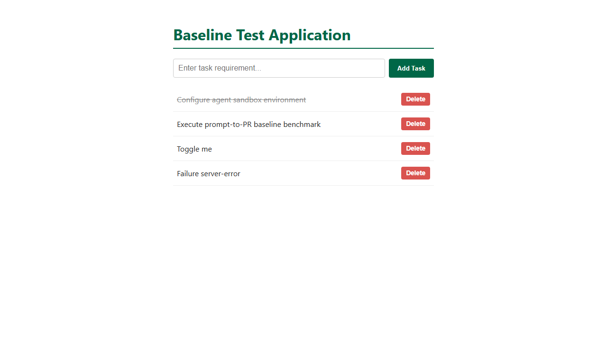
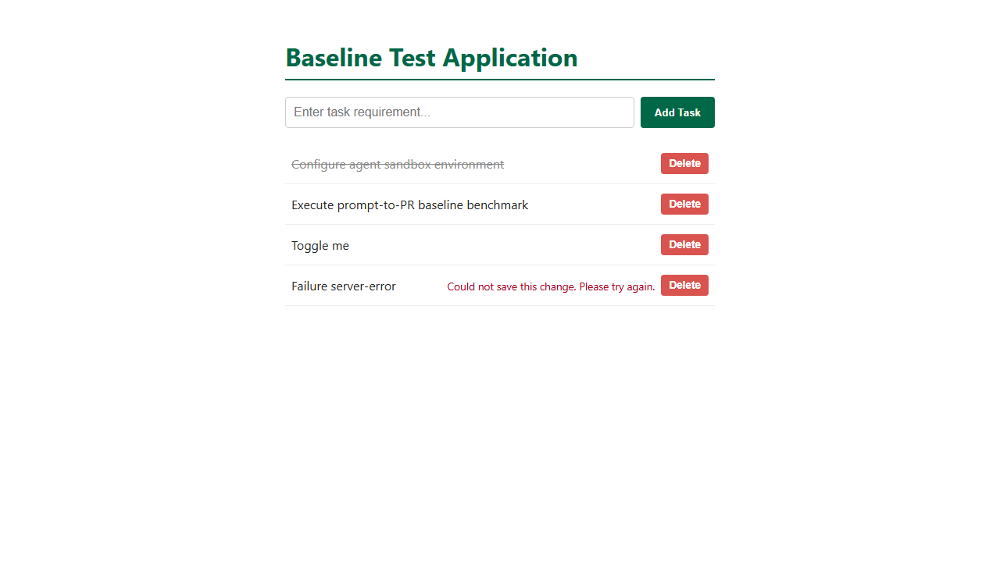

# Task 004 acceptance criteria, with before and after evidence

- **Task:** [pipeline/tasks/004-fix-update-validation.md](../../../pipeline/tasks/004-fix-update-validation.md)
- **Starting app:** commit `4e258a96855d98edd10247f68c0b8265e53a8921`, the same
  starting point as task 003 (it can add, toggle and delete; it has no title-edit UI).
- **"Before"** is that app unchanged. **"After"** is the reference fix in
  [`reference/`](reference/), which must never be put in an agent's workspace.
- **Evidence** was recorded on 2026-10-17 with Windows 11, Node v24.22.0,
  npm 11.19.1 and Playwright 1.64.1 (Chromium headless shell v1248).

## Why these bugs

Task 003 already requires that `PUT` reject invalid titles, so this task
leaves titles alone. It covers the `PUT` bugs that task 003 does not cover:

| Bug | Where in the "before" code | What a user sees |
|---|---|---|
| B1 | `todo.completed = Boolean(req.body.completed)` | `"false"` is a non-empty string, so it becomes `true`: un-checking from a script checks the todo |
| B2 | `parseInt(req.params.id, 10)` | `5abc` updates todo 5, and `1.0` updates todo 1. DELETE already rejects these, so the two endpoints disagree |
| B3 | no check on the body's shape | an array body returns 200 and silently does nothing |
| B4 | `toggleStatus()` never checks the response | when saving fails, the page gives no feedback at all |

## Results summary

| Suite | Before | After |
|---|---|---|
| Hidden API tests, counting subtests | **5 / 24 pass** (exit 1) | **24 / 24 pass** (exit 0) |
| Hidden browser tests | **2 / 4 pass** (exit 1) | **4 / 4 pass** (exit 0) |
| Local `npm test` | 9 / 9 pass | 14 / 14 pass (9 original + 5 new) |

Raw logs: [`evidence/before/`](evidence/before/) and [`evidence/after/`](evidence/after/)
(`api-tests.txt`, `browser-tests.txt`, `local-tests.txt`, `exits.txt`).

## Acceptance criteria

### API (`update-bugfix-api.test.cjs`)

Every rejection test also checks that the response body is `{ error: "<non-empty>" }`
and that `GET /api/todos` is identical before and after the request.

| ID | Criterion | Check | Before | After |
|---|---|---|---|---|
| API-01 | `completed` must be a JSON boolean, otherwise 400 | `PUT {completed: X}` for X in `"false"`, `"true"`, `0`, `1`, `null`, `{}`, `[]` | ✖ 0 / 7 (all return 200 and change the todo) | ✔ 7 / 7 |
| API-01 | The bug as reported: `"false"` must not check a todo | `PUT {completed: "false"}`, then GET | ✖ todo became `completed: true` | ✔ |
| API-02 | Ids follow the DELETE rules, otherwise 400 | ids `5abc`, `-5`, `0`, `0x1`, `1.0`, `abc`, `9007199254740992` | ✖ 0 / 7 (200 or 404) | ✔ 7 / 7 |
| API-02 | Leading zeros are allowed | `PUT /0<id>` returns 200 and updates that todo | ✔ (guard) | ✔ |
| API-02 | A valid id with no todo returns 404 | `PUT /999999` | ✔ (guard) | ✔ |
| API-03 | A non-object body returns 400 | body `[{completed: true}]` | ✖ returned 200 | ✔ |
| API-04 | A rejected request changes nothing | `{title: "Atomic replacement", completed: "true"}` | ✖ title and completed both changed | ✔ |
| API-05 | Boolean updates work in both directions | `true` → `false` → `true`, each returns 200 with the full todo | ✔ (guard) | ✔ |
| API-05 | Valid title updates still work | `"  After rename  "` is stored as `"After rename"` | ✔ (guard) | ✔ |
| API-05 | GET, POST and DELETE are unchanged | blank POST returns 400; DELETE `/0<id>` returns 204, then 404; DELETE `/abc` returns 400 | ✔ (guard) | ✔ |

"Guard" rows pass both before and after. They are there to catch an agent
that breaks working behaviour while fixing the bugs.

### Browser (`update-bugfix.browser.spec.cjs`)

| ID | Criterion | Check | Before | After |
|---|---|---|---|---|
| UI-01 | A toggle is saved and survives a reload | click, check via API, reload, click again | ✔ (guard) | ✔ |
| UI-02, UI-03 | When the server returns 500: a visible, non-empty `role="alert"` appears in that row, and the row looks the same as before the click | `PUT` is intercepted and answered with 500 | ✖ no alert appears | ✔ |
| UI-02, UI-03 | Same, when the request fails at the network level | `PUT` is intercepted and aborted | ✖ no alert appears | ✔ |
| UI-04 | Add and delete still work | add a todo in the UI, then delete it | ✔ (guard) | ✔ |

"Looks the same" is checked without depending on the markup: the test
compares every element's text decoration and checkbox state, ignoring the
alert. Rows are found by their title text, so agents don't need to add
`data-todo-id`.

### Screenshots: server returns 500 after clicking "Failure server-error"

| Before: nothing happens | After: the error appears in that row |
|---|---|
|  |  |

The network-failure versions are in `evidence/*/UI-02-network-error.png`.

## Scope rules checked during review (not automated)

- Only `app/public/index.html`, `app/server.js` and `app/test.js` changed.
- No package files or dependencies changed. DELETE and the title rules are unchanged.
- The original 9 local tests are still present, and new local tests cover API-01 to API-04.
- The agent's report names the cause of each reported bug (B1 and B4 at least).

## Score levels this task can show

From [`evidence/validation-checks.txt`](evidence/validation-checks.txt):

| App version | API | Meaning |
|---|---|---|
| Unchanged | 5 / 24 | nothing fixed |
| Fixes only the `Boolean()` bug | 15 / 24 | fixed the reported symptom only |
| Reference fix | 24 / 24 | everything fixed |

So an agent that patches only the reported symptom scores visibly lower
than one that finds the related id and body-shape bugs.
