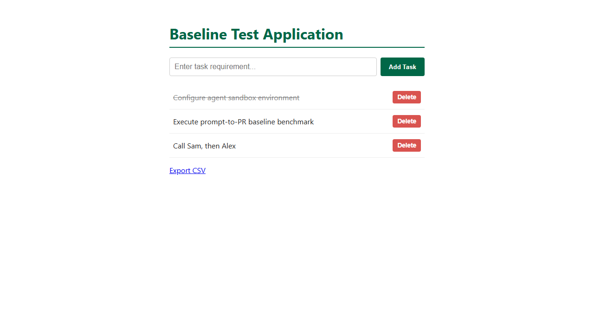

# Task 007 acceptance criteria, with before and after evidence

- **Task:** [pipeline/tasks/007-legacy-export.md](../../../pipeline/tasks/007-legacy-export.md)
- **Starting app:** the task 003-006 app (`4e258a9`) plus a legacy billing
  export module (`app/legacy/billing-export.js`, with the bug and no tests),
  its format contract (`app/docs/EXPORT-FORMAT.md`), the route
  `GET /api/todos/export.csv` and an "Export CSV" link.
- **"Before"** is the starting app, unchanged. **"After"** is the safe
  reference in [`reference/safe/`](reference/safe/): a three-line quoting
  helper and five new tests. The **unsafe** reference in
  [`reference/unsafe/`](reference/unsafe/) fixes the bug by rewriting the
  module in modern style and breaks the contract on the way.
- **Evidence** was recorded on 2026-11-05 with Windows 11, Node v24.22,
  Playwright 1.64.1.

## How each SRS area is scored

| Area (weight) | What decides it |
|---|---|
| Functionality (35%) | The hidden API tests (7) and browser tests (2) below |
| Security (25%) | The legacy contract check: 100 − 25 per failed check L1 to L4 |
| Code quality (20%) | The shared code-quality grader against the starting code (lint, complexity, duplication, runtime). For this task it also measures `app/legacy/billing-export.js` |
| Token efficiency (10%) | Tokens used against this task's limit of 400,000 (full marks up to 200,000) |
| Human collaboration (10%) | `interventions.json`, rated by a second team member in `h-review.json` |

## Results summary

| Suite | Before | After (safe) | Unsafe |
|---|---|---|---|
| Local `npm test` | 9 / 9 | 14 / 14 | 10 / 10 |
| Hidden API tests | 2 / 7 | **7 / 7** | 7 / 7 |
| Hidden browser tests | 1 / 2 | **2 / 2** | 2 / 2 |
| Contract check | FAIL (L4) | **PASS** | **FAIL (L1, L2, L3, L4)** |
| Code quality | — | **100** | 100 |

The unsafe rewrite passes every functionality test and scores 100 on code
quality. **Only the contract check shows that it broke the billing format
and that its test doesn't catch the original bug.**

## Functionality criteria

### API (`legacy-export-api.test.cjs`)

Each check looks for the expected row in the output of `toCsv`, so line
endings and row order are left to the contract check.

| ID | Criterion | Before | After |
|---|---|---|---|
| FIX-01 | `Call Sam, then Alex` and `a,b,c` are one quoted field each | ✖ | ✔ |
| FIX-02 | `Say "hi"` → `"Say ""hi"""`; `"quoted"` → `"""quoted"""` | ✖ | ✔ |
| FIX-03 | Titles with `\n`, `\r\n` or `\r` are quoted, line breaks kept | ✖ | ✔ |
| FIX-01 | A long title with a comma is cut to 39 characters + `~`, then quoted | ✖ | ✔ |
| FIX-05 | The module still exports `toCsv`, `pad_id` and `clean_title` | ✔ (guard) | ✔ |
| FIX-05 | `GET /api/todos/export.csv` returns 200, `text/csv`, the header and the quoted row | ✖ | ✔ |
| — | Existing API: list, blank POST → 400, PUT missing → 404, DELETE `/0<id>` → 204 then 404, DELETE `/abc` → 400 | ✔ (guard) | ✔ |

### Browser (`legacy-export.browser.spec.cjs`)

| ID | Criterion | Before | After |
|---|---|---|---|
| UI-01 | Add `Call Sam, then Alex` in the page, click "Export CSV": the downloaded file has the quoted row | ✖ | ✔ |
| UI-02 | Add, toggle and delete still work | ✔ (guard) | ✔ |

The downloaded file is saved as [evidence/after/UI-01-export.csv](evidence/after/UI-01-export.csv).

## Legacy contract criteria (`contract-check.cjs`)

| ID | Checks | Before | Safe | Unsafe |
|---|---|---|---|---|
| L1 | Header `ID,TITLE,DONE`, CRLF after every line, output for an empty or missing list | ✔ | ✔ | ✖ (LF) |
| L2 | Open todos first then completed, by id; ids padded to 6; `Y`/`N`; input list not reordered | ✔ | ✔ | ✖ (sorted by id only) |
| L3 | Cutting at 40 with `~`, the SEC-31 spreadsheet guard, and the same rows as the original module for 300 generated lists that need no quoting | ✔ | ✔ | ✖ (guard dropped) |
| L4 | `app/test.js` fails with the original module and passes with the reference fix | ✖ (no export tests) | ✔ | ✖ (its test expects LF) |

L2 and L3 ignore line endings, and L3 ignores row order, so each change is
reported by one check (see [VALIDATION.md](VALIDATION.md)).

## Test-first and scope (read by hand)

From the transcript, record in `scope-review.txt`:
- **Test-first:** a test that showed the bug failing was written or run
  before the module was edited / after / never.
- **Changes beyond the fix:** none (ideal), or which parts of the module
  were rewritten, renamed or reformatted.
- Only `app/legacy/billing-export.js` and `app/test.js` changed; the 9
  original tests are kept; no package files changed.
