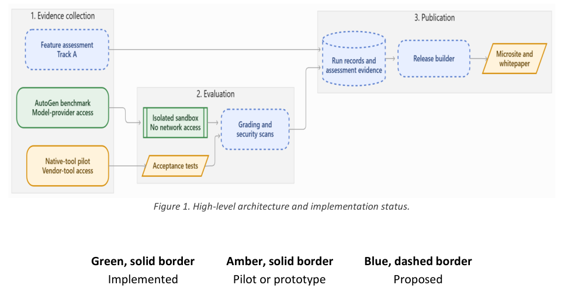
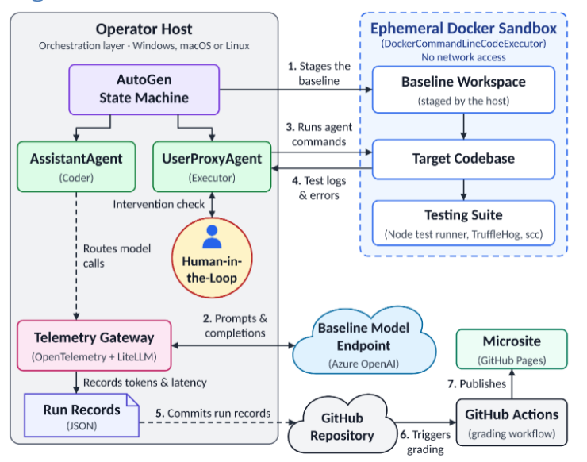
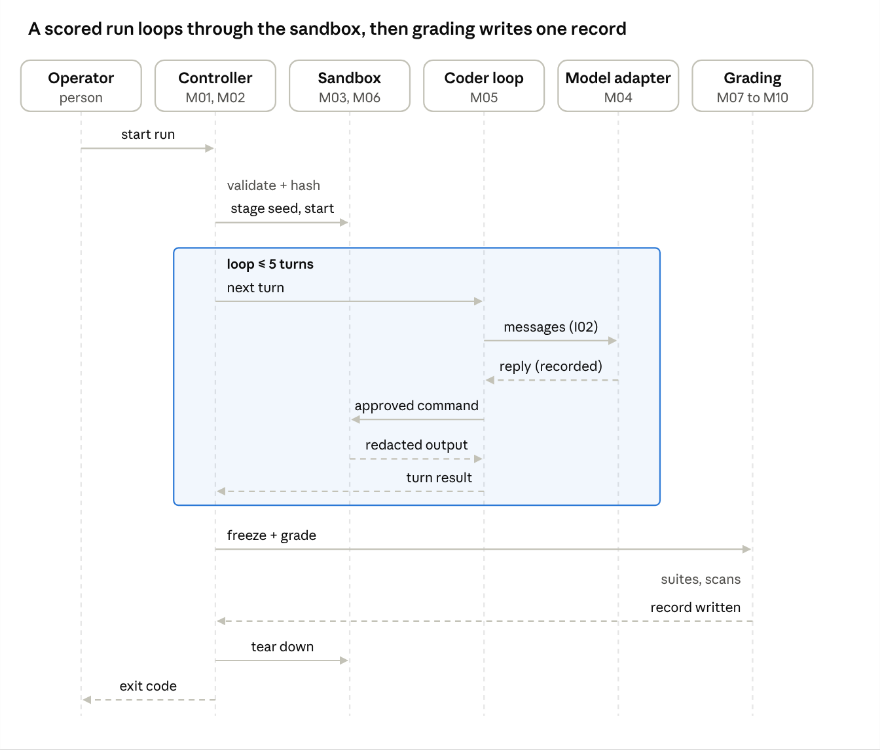
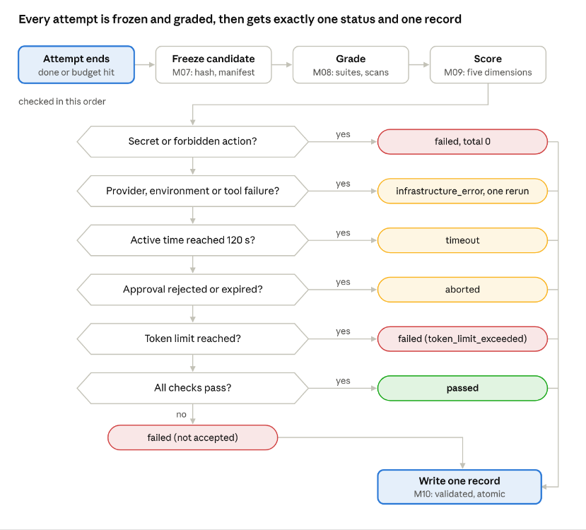
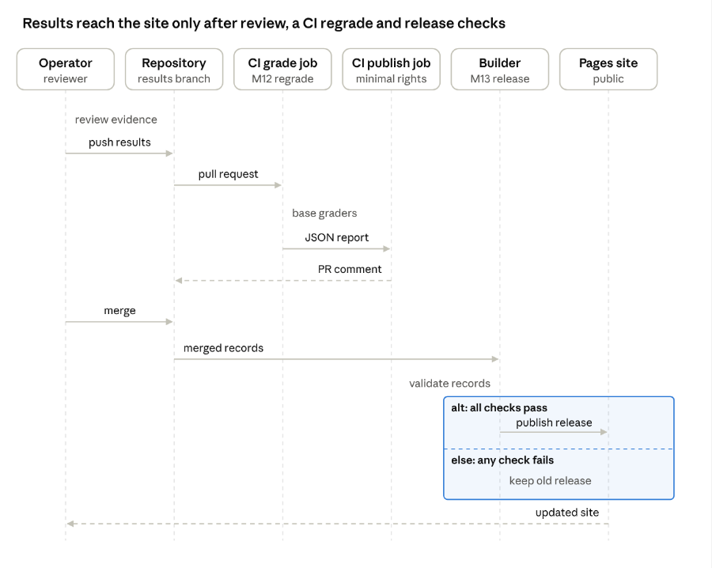
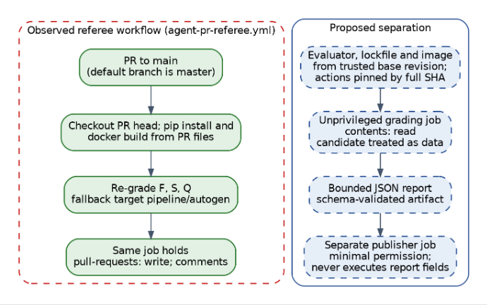

# Detailed Design Document

> Working Markdown source, version 1.5 (October 16, 2026). Version 1.5 is built from DDD version 1.4 (PDF supplied October 15, 2026; [baseline PDF](../references/baselines/ddd_2026-10-15_v1.4.pdf)), which is the baseline for text, figures and identifiers. Additions kept from the earlier Markdown import (version 1.0, October 14, 2026) and the version 1.5 consistency changes are listed under "Merge notes" below. Document claims about code and experiments are imported claims, not new verification. Tables and headings were converted for editing; the figures were extracted from the version 1.4 PDF. Team review of the conversion and merge is pending.

## Document Control

| Field | Value |
| --- | --- |
| Project | Microsoft 2, Team 3 |
| Course | CIS-4910 Senior Project Fall 2026 |
| Authors | Bruno Rocha; Kapil Srikanth; Ross Volenec; Joseph Bressani |
| Sponsors | Chad Hage; Brad Lawrence |
| Version | 1.5 October 16, 2026 |
| State | Working source; conversion and merge review pending |

### Document Version History

| Date | Version | Author | Change reference |
| --- | --- | --- | --- |
| 16-October 26 | 1.5 | Team 3 (AI-assisted draft) | Markdown source rebuilt from version 1.4 with version 1.0 additions merged; Approach A/B/C terminology used throughout; consistency pass (see Merge notes). Review pending. |
| 15-October 26 | 1.4 | Team 3 | Added Public Health, Safety, and Welfare section. |
| 15-October 26 | 1.3 | Team 3 | Rubric Review |
| 15-October 26 | 1.2 | Team 3 | Added behavioral view; expanded logical, physical, and data view |
| 13-October 26 | 1.1 | Team 3 | Updates from Oct. 9 Sponsor Meeting |
| 7-October 26 | 1.0 | Joseph Bressani | Initial DDD draft |
| 7-October 26 | 1.0 | Kapil Srikanth | Initial DDD draft |
| 7-October 26 | 1.0 | Bruno Rocha | Initial DDD draft |
| 7-October 26 | 1.0 | Ross Volenec | Initial DDD draft |

### Merge notes

Version 1.5 takes its text, figures and identifiers from version 1.4. None of the changes below has been independently reviewed.

Content kept from the earlier Markdown import (version 1.0 text) because version 1.4 does not contain it:

- Scope items, goal 7, the M11 processing row, the Approach A data tables and the matching traceability rows for the documentation-only feature assessment (SRS F6, Requirement 5).
- The Cross-Cutting Concerns section, the Capacity and scaling subsection and the Risks, Assumptions and Mitigations section.
- The traceability table by SRS specification, kept beside the version 1.4 matrix by feature.
- The decision record for the documentation-only assessment, renumbered ADR-14 because version 1.4 uses ADR-13 for the shared-evaluator procedure.
- Glossary terms that version 1.4 does not define.

Version 1.5 consistency changes:

- Terminology: Approach A, B and C (the version 1.4 overview table) is used throughout. The earlier import's "Track A" and "Track B" labels were removed. The SRS, the matrix specification and the assessment record file still use "Track A"; they are separate sources and were not changed.
- System Coupling cites Figure 2 (logical view) for dependency direction; version 1.4 cited Figure 4, which is the data view.
- Constraint C-1 no longer mentions an embedded database, which contradicted ADR-09 and Spec 3.1.
- Sponsor and Context no longer says differences come from the tooling "not the model", because Approach B records a different default model per tool. Approach C fixes the model.
- Wording and spelling fixes: the Purpose paragraph, Module Processing step 5, the note on tasks T3 to T8, and the last sentence of the High Level Architecture text.
- Configuration wording: "shipped defaults" is softened to "recorded configuration (shipped defaults where possible)" in Sponsor and Context, the Benchmark Approaches table, C-9, ADR-13 and the traceability and public-welfare rows.
- A-2 no longer lists an Antigravity CLI. The 120 s active-time limit is kept, and the Antigravity timing risk now says Approach B times are not comparable to it.
- The two Copilot profiles in the matrix specification are described as placeholders.
- Schema 3 is described as the working design adopted from Kapil Srikanth's revision; the SRS amendment is on hold. The term unavailable is proposed for measurements that could not be captured.
- The Physical view records the decision to use separate containers (Figure 3); the evaluator access mechanism is an open point.

Content adopted from Kapil Srikanth's proposed revision 1.5 (reference PDF `ddd_2026-10-15_kapil_rev1.5-proposed.pdf`, AI-assisted per its Appendix C, not team-approved). This source stays the baseline; only the following were taken, reworded to this document's terminology and kept as proposed:

- Interfaces: request and response shapes, preconditions and error codes for I01 to I09, and the notes on transport, retries, approvals and opaque storage handles.
- Module Processing: the terminal-treatment column and the closing note on status resolution.
- Database servers, design and Schemas: the proposed schema 3 run record, the supporting contracts and the call-record rules.
- Cross-Cutting Concerns: the event fields and redaction approach for observability, the start journal and recovery sweep, and the configuration rules.
- Not adopted: its ADR numbering (it uses ADR-13 for the documentation-only assessment and ADR-14 for native pilots, the reverse of this document), its Track A and Track B wording, its removal of the pilot results table and the assumptions table, and its demo-planning text. Its physical design (candidate server and evaluator in one container) conflicts with Figure 3 and is not applied.

Where version 1.4 and the earlier text disagree, version 1.4 is used. Other inconsistencies found inside version 1.4 are kept as written and tracked in the team's task list, not silently fixed: references (D05, D06, D09, V02 to V05, E15) that are never defined. Resolved by team decision: A-2 no longer lists an Antigravity CLI (Antigravity is IDE-only, as C-6 says), and version 1.5 is dated October 16, 2026, the soft due date for the course presentation; the earlier history rows keep their original dates.

## Introduction

### Purpose

The Detailed Design Document (DDD) is meant to translate the System Requirement Specification (SRS) for this project into an implementable architecture. The harness provides an AI coding agent with a coding task, it will then run in an isolated sandbox and grade the results independently and publish a side-by-side comparison for different metrics we believe most software engineers would deem valuable. These metrics are correctness, security, code quality, token efficiency, and the human help the agent needs. This document defines the architectural style, the components and their responsibilities, the interfaces between them, the data they persist, the infrastructure they run on, and the design decisions and trade-offs behind each choice.

### Sponsor and Context

The project is sponsored by Microsoft (Chad Hage, Brad Lawrence). The group must decide which AI coding agent to adopt and has no objective, repeatable way to compare the candidates. The initial agents are OpenAI Codex, Anthropic Claude Code, GitHub Copilot, and Google Antigravity. Every agent runs in a recorded configuration (its shipped defaults unless a deviation is recorded), so differences in the results come from the tool and its model. Approach C fixes the model so that agents can be compared on tooling alone.

### Scope

In scope:

- A standard reference application with automated tests (F1).
- Isolated, credential-free execution of agent-generated code (F2).
- Orchestration of agent runs under turn, time, token, and cost limits (F3).
- Independent grading, including secret and license scans (F4).
- Per-run telemetry and public results microsite (F5).
- A separate documentation-only feature assessment of commercial tools, Approach A (F6, SRS Requirement 5), designed as module M11.

Out of scope:

- Installing, running, or live-testing the tools assessed in Approach A.
- Training or fine-tuning models.
- Comparing models against each other.
- Benchmarks other than the JavaScript reference application.
- Running the harness as a hosted service; it runs on the operator’s machine.
- Deploying agent-generated code to any production system.
- Third-party extensions such as SpecKit in the baseline comparison

## Architectural Description Framework

The document is an architecture description in the sense of ISO/IEC/IEEE 42010:2022 [10]. It identifies the system’s stakeholders and their concerns and answers each concern with a view. The views follow Kruchten’s 4+1 view model [11] (logical, physical, behavioral/process, development and scenarios) plus a data view, as required for this course.

Each stakeholder concern below is answered by at least one view or section of this document.

| Stakeholder | Key concerns | Answered by |
| --- | --- | --- |
| Sponsor (Chad Hage, Brad Lawrence) | Which tool pipeline is production-ready; fair, repeatable comparison; security of the recorded configuration; weekly demos | Benchmark Approaches; Scenarios view; Security Considerations; C-8, C-9; ADR-01 |
| Course instructors and peer reviewers | Rigor, SRS traceability, internal consistency, feasibility | SRS Traceability Matrix; Architecture Decision Records; all views |
| Team developers | Module responsibilities, interfaces, where code lives, how it is built and tested | Logical view; Interfaces; Development view; Module Specifications |
| Benchmark operators (team members running pilots) | Repeatable procedure, isolation of the agent, evidence that survives review | Behavioral view (Figures 5 and 8); Physical view; Scenarios view |
| Results readers (microsite visitors) | Honest, comparable, clearly labeled results | Data view; Figure 7; Web servers; ADR-01 |
| USF and Microsoft compliance | No personal data or secrets; least privilege; monitored workloads | Physical view; Security Considerations; C-7 |

Viewpoints and notations used:

| View (viewpoint) | Notation | Where |
| --- | --- | --- |
| Logical | Component diagram (layered modules) | Figure 2; System Decomposition |
| Physical | Deployment diagram with trust zones | Figure 3; node table |
| Data | Entity-relationship diagram; schema tables | Figure 4; Database servers, design and Schemas |
| Behavioral (process) | Sequence and activity diagrams | Figures 5–8 |
| Development | Repository and branch tables | Development view |
| Scenarios (+1) | Walk-throughs of Task 001 and Task 003 | Scenarios view |

## Benchmark Approaches

The project compares tools through three approaches that share one evaluator, one evidence layout and one publication path, but are never mixed in one score (ADR-01, ADR-13).

| | A. Feature matrix | B. Native-tool pilots | C. AutoGen harness |
| --- | --- | --- | --- |
| Question answered | What each tool documents it can do | How each vendor pipeline performs in its recorded configuration, shipped defaults where possible (sponsor’s main question) | How agents perform under identical, enforced limits |
| Who drives the agent | No agent; reviewers read documentation | The operator, using the vendor’s own CLI or IDE (Codex CLI, Claude Code, Copilot CLI, Antigravity) | The harness controller (M02) through the model adapter (M04) |
| Model | Not applicable | Tool’s default selection, recorded per run | Pinned model profile (azure-prod) |
| Limits enforced by | Not applicable | The tool’s own approvals and sandbox, recorded by the operator | Host-enforced turns, time, tokens and container limits (ADR-03) |
| Modules used | M11, M13 | Procedure replaces M02–M07 (see mapping below); M08, M10 record format, M12, M13 | M01–M10, M12, M13 |
| Scored with formulas (M09) | No | No; raw suite results, time, approvals and tokens are reported | Yes |
| Status | Specification v0.2 [4] | Nine pilot runs complete across four tools and two tasks (Scenarios view) | Partial implementation |

How Approach B maps onto the architecture. The written procedure [8], [24] performs by hand what harness modules do automatically, so the evidence it produces fits the same record and publication path:

| Harness module | Approach B equivalent |
| --- | --- |
| M01 Contracts | Fixed starting commit, agreed evaluator commit and grader hashes recorded before the run |
| M03 Staging | git archive snapshot of app/ and the task file only, with no Git metadata or graders |
| M05 / M06 Coder loop and sandbox | The vendor tool’s own agent loop, approvals and sandbox; settings recorded, not enforced |
| M07 Freezer | Original files copied and before/after SHA-256 manifests compared |
| M08 Evaluation | The same evaluator-owned suites, run outside the agent workspace |
| M10 Record writer | A results README plus manifests, logs and transcripts on a results branch |

A native tool can move from Approach B into Approach C only through a tool adapter that reports its capabilities over interface I09 (headless mode, model pinning, sandbox routing, usage reporting). Tools that cannot meet I09 stay in Approach B.

## Architectural Goals, Constraints and Assumptions

### Goals

The architecture is designed to achieve the following goals:

1. Repeatable evaluation: Give each agent the same baseline application, task prompt, permissions, and execution limits. Reset the application before every run.

2. Safe execution: Isolate agent-generated code from host credentials, unrelated files, and external networks.

3. Independent grading: Evaluate submitted changes using protected acceptance tests and security scans that the agent cannot modify.

4. Controlled automation: Allow agents to generate changes, receive execution feedback, and attempt corrections within defined resource and execution budgets.

5. Traceable results: Record configuration, test results, security findings, token usage, execution time, and human involvement for each run. Publish comparable results through the microsite.

6. Extensibility: Separate agent integrations from task definitions, sandbox management, and grading so additional agents can be evaluated without redesigning the entire harness.

7. Honest uncertainty (Approach A): Report documented capability with a source for every finding, treat unknowns as “Not established” rather than as zero, and never present documented availability as measured effectiveness (SRS Requirement 5).

### Constraints

| ID | Constraints | Source | Architectural Impact |
| --- | --- | --- | --- |
| C-1 | The harness runs on the operator’s machine and not as a hosted service | SRS Scope | Local-first design: CLI and Docker; no database server and no multi-tenant web back end |
| C-2 | Only the JavaScript reference application is benchmarked | SRS Scope |  |
| C-3 | Budget is limited to the $100 Azure credit given to us by the sponsor. | Initial Sponsor Meeting | Hard per-trial token and cost caps; small pinned model; trial count configurable. Approach B tools run on each member’s own tool plan; their usage is recorded when the tool reports it |
| C-4 | Fixed schedule based on the semester; Final Demo on Dec 4th,2026. | Course Syllabus | Limits scope of what can be done in the short amount of time provided. |
| C-5 | Agent-generated code is never deployed to production | SRS Scope | Execution limited to disposable containers; no deployment credentials in the sandbox |
| C-6 | Each agent must be driven non-interactively | Repeatability Goal | Only tools that meet I09 join the harness; IDE-only tools such as Antigravity stay in Approach B, where every approval is logged |
| C-7 | USF policy, FERPA and Microsoft usage guardrails apply; sponsor workloads are monitored | Initial Sponsor Meeting | No personal data in results; least-privilege access to Azure; the public microsite contains only redacted, aggregated evidence. |
| C-8 | Demo expected at every weekly meeting; a video linked in the GitHub issue is acceptable | Sponsor Meeting, Oct. 9th | Runs are scripted as any member can demo them. |
| C-9 | Tools run in a recorded configuration, shipped defaults where possible; extensions are excluded (e.g. SpecKit) | Sponsor Meeting, Oct. 9th | Record the exact model, reasoning and approval settings and any deviation from the defaults; do not assume every run used defaults. |

### Assumptions

| ID | Assumption | If false, then… |
| --- | --- | --- |
| A-1 | The operator’s workstation can run the Docker Engine and has a Desktop with at least 16 GB RAM and 100 GB free disk space. | Runs trials sequentially or uses an Azure VM as the operator machine |
| A-2 | Each CLI agent admitted to Approach C (Codex CLI, Claude Code, Copilot CLI) supports a headless mode and either a base-URL override or reports token usage. Antigravity is IDE-only (C-6) and stays in Approach B. | Adapter falls back to parsing the agent’s own usage output; result would be flagged for “self-reported usage” |
| A-3 | Published results contain no confidential information. | Publisher redaction rules block the publishing step. |
| A-4 | Model outputs are non-deterministic; N ≥ 3 trials per agent/task give a usable estimate | Increase N for close comparisons; report confidence intervals rather than single runs |
| A-5 | One member runs each tool end to end with identical task files and prompts | Results are not comparable; rerun from benchmark-start-v1 |
| A-6 | Each tool's models stay available through Dec. 4th | Record model version per run; a new version starts a new cohort |
| A-7 | Each tool reports per-run tokens | Token score is dropped; totals are out of 90 |

## Artificial Intelligence Impacts and Uses

### AI Assisted Content Notation

Portions of this document were prepared with the assistance of generative AI tools. As a team, any input received from AI was reviewed, edited, and verified against the contents of the SRS, sponsor meeting notes, and the project repository. Diagrams were produced with Mermaid or Claude to ensure a more professional view compared to doing it by hand.

| Section or figure | Version | AI role | Source checked against | Human judgment |
| --- | --- | --- | --- | --- |
| Sections and figures not listed below | 1.0 | AI-assisted drafting and editing | SRS [2], sponsor notes [3], repository [1] | Team authored, edited and verified |
| Sponsor and Context; C-8, C-9; A-5–A-7; pilot paragraph; Security Considerations text and Table 21 | 1.1 | AI-drafted | Oct. 9 meeting transcript [3]; repository | Reviewed, edited and verified by the team against the listed sources |
| Logical, physical and data view text; Figures 5–7 | 1.2 | AI-drafted from existing DDD content | Sections of v1.1 | Reviewed, edited and verified by the team against the listed sources |
| Architecture Description Framework; Benchmark Approaches; revised C-3, C-6, A-2; Figure 8; Development and Scenario views; expanded ADRs and ADR-13; Traceability Matrix; pilot evidence; Appendices A–C | 1.3 | AI-drafted | Results branches and procedures in [1], [8], [24]; SRS [2] | Reviewed, edited and verified by the team against the listed sources |
| Markdown conversion of version 1.4; merge of version 1.0 additions (see Merge notes); extraction of figures from the version 1.4 PDF; Approach A/B/C terminology and consistency changes | 1.5 | AI-assisted conversion, merge and editing | Version 1.4 PDF; version 1.0 Markdown import | Team review pending |
| Interfaces I01–I09; Module Processing terminal treatment; schema 3 record and supporting contracts; observability, recovery and configuration text | 1.5 | Drafted by Kapil Srikanth with ChatGPT/Codex (his Appendix C); adapted and merged here with AI assistance | Kapil's proposed revision 1.5 PDF; this document's terminology | Team review pending |

AI coding agents are also the subject of this project: their outputs are evidence to be graded, never trusted inputs. Every agent-written file is preserved, hashed and graded by evaluator-owned suites, and the public site labels agent-generated code as AI-generated (Spec 4.4).

## Scope of Project Architecture

The harness is a modular monolith organized as a layered architecture whose core workflow is a pipes-and-filters pipeline (Plan → Execute → Grade → Score → Publish). Agent integrations use a plug-in (microkernel) style: the orchestrator is the stable core, and each agent is an adapter loaded from a registry. Telemetry follows an event-based, append-only style (every stage emits events to a log that is later ingested). The results microsite follows a static-site (JAMstack) style. Each choice is tied to a requirement or constraint below; the rejected alternatives are discussed in ADR-01, ADR-05 and ADR-11.

### High Level Architecture (HLA)



Figure 1. High-level architecture and implementation status. Green, solid border = implemented; amber, solid border = pilot or prototype; blue, dashed border = proposed.

Evidence producers generate candidate code or documented findings. Candidate code is graded inside the trusted evaluation boundary. Graded results become run records that a release builder publishes. Readers cannot start runs.

### Architectural Views

#### Logical

The logical view decomposes the harness into four layers, each with one responsibility; the module table under System Decomposition (M01–M13) gives the full list with code and status.

- Contracts and control: M01 Contracts validates the task, profile, policy and campaign; M02 Controller owns the run lifecycle, budgets and final status.
- Execution: M03 Staging copies the seed without credentials; M04 Model adapter records every provider call; M05 Coder loop counts turns and requests approvals; M06 Sandbox enforces container limits and teardown.
- Evaluation: M07 Freezer hashes the candidate and enforces the file manifest; M08 Evaluation runs evaluator-owned suites and scans; M09 Scoring applies the metric contract.
- Records and publication: M10 Record writer writes one validated record per run; M11 Assessment holds Approach A feature-matrix cells; M12 Export and referee regrades in CI; M13 Release builder publishes reviewed records to the site.

The implementation differs from the SRS view: it uses CodeExecutorAgent instead of UserProxyAgent, wraps the model client instead of using a LiteLLM gateway, grades pull requests with code from the pull request itself, and does not publish run records.



Figure 2. Logical architecture. The figure is the SRS-era view and still shows AssistantAgent, UserProxyAgent, a LiteLLM telemetry gateway and a Human-in-the-Loop node; the paragraph above lists where the implementation differs.

#### Physical


Figure 3. Physical architecture and implementation status. Green, solid border = implemented; amber, solid border = pilot or prototype; blue, dashed border = proposed.

The physical view places every component on one of three trust zones.

| Node | Runs | Network | Holds secrets |
| --- | --- | --- | --- |
| Operator workstation (trusted) | Python controller (AutoGen, Git, Docker SDK); evaluator bundle; run records; Approach B vendor tools and their isolated snapshot folders | Host-only HTTPS to GitHub and the model provider | Yes: .env read by the host, never mounted into containers |
| Docker engine (untrusted execution) | Agent container with scratch workspace; frozen-candidate and scanner containers (proposed) | None (--network none); evaluator reaches the candidate over loopback only | No |
| GitHub (hosted) | Repository and results branches; Actions referee job; Pages static site | Public | No model credentials; the publishing job alone gets write permission (proposed, ADR-11) |
| Model provider (hosted) | Azure model deployment (azure-prod profile for scored runs) | Called only from the host adapter | API key stays on the host |

#### Data


Figure 4. Data relationships.

A RunRecord links one task, one profile, and one campaign to its calls and grader results. Corrections are separate records linked by phase and retry_of. Approach A uses AssessmentCells. A release manifest selects reviewed records by hash.

Persistence strategy. All state is versioned JSON files; no database server runs (ADR-09). Every file is written to a temporary path, validated against JSON Schema 2020-12, then renamed, so a crash never leaves a half-written record. Raw logs and transcripts stay on the operator machine; only redacted records are committed to a results branch, and only reviewed records selected by hash in a release manifest reach the public site.

Data flow.

1. Task manifest, model profile and campaign manifest are hashed at validation (M01).
2. Each provider call and command is appended to the run’s event log (M04, M05).
3. Grader results attach to the RunRecord with suite hashes (M08); scores follow (M09).
4. M10 writes one terminal RunRecord per run; corrections are new records linked by retry_of.
5. Reviewed records are committed to benchmark-results/<tool>/<run>/, then copied into site/data/<release>/ by M13. Approach B evidence follows the same path from step 5.

#### Behavioral

The behavioral view shows the four workflows the system runs most: one scored harness run, the grading decision for a finished attempt, publication of results, and one native-tool pilot run.

##### Scored harness run (Approach C)



Figure 5. Sequence: one scored harness run (Approach C)

The controller validates and hashes every input before a run ID exists, then drives at most five coder turns inside a network-less container; every model call is recorded and every command result is redacted before the agent sees it. Only after the candidate is frozen do evaluator-owned suites grade it. Each admitted run produces one validated record when finalization storage is available; the process exit code summarizes the outcome.

##### Grading and final status



Figure 6. Activity: grading and final status of an attempt

Whether the agent finished or ran out of budget, the candidate is frozen and graded before any status is chosen. Conditions are checked in the order of the Module Processing status table, so a leaked secret or forbidden action overrides every other outcome. Every path ends in exactly one validated record. Approach B runs use the freeze and grade steps but report raw suite results instead of a status from M09.

##### Review, CI regrade and publication (proposed)



Figure 7. Sequence: review, CI regrade and publication (proposed)

An operator reviews evidence before pushing it to a results branch; the pull request is regraded by an unprivileged CI job that uses base-branch graders and treats candidate output as data, and a separate minimal-permission job posts the comment (ADR-11, Spec 4.5). After merge, the release builder validates records and publishes them to GitHub Pages within 2 minutes (Spec 4.4); if any check fails, the previous release stays live. Today’s referee workflow still grades and comments in one job (see Security Considerations).

##### Native-tool pilot run (Approach B)


Figure 8. Sequence: one native-tool pilot run (Approach B)

The operator exports only app/ and the task file from the fixed starting commit into a fresh folder, records the tool’s configuration and grader hashes, and sends the exact prompt. The vendor tool works only inside that snapshot, asking the operator for approvals in its own way. When it reports, the operator saves the original files before any feedback, grades them with evaluator suites kept outside the snapshot, and pushes evidence to a results branch. This is the procedure behind all nine pilot runs in the Scenario view.

#### Development

The development view shows where each part of the system lives in the repository, how branches separate frozen inputs from results, and how code is built and tested.

Repository layout (master).

| Path | Contents | Modules |
| --- | --- | --- |
| app/ | Node/Express todo testbed and its node:test suite | Testbed |
| baseline/ | Clean copy of the testbed (5 passing tests, V02) | Testbed |
| pipeline/autogen/harness/ | Harness Python package: tasks.py, model_profiles.py, staging.py, instrumented_client.py, orchestrator.py, executor.py, scoring.py, telemetry.py, pr_export.py, referee.py, plus verify_*.py self-checks | M01–M06, M09, M10, M12 |
| pipeline/autogen/graders/ | Functionality, security, quality and Node graders | M08 |
| pipeline/autogen/run_benchmark.py | Command-line entry point | M02 |
| pipeline/autogen/tests/ | pytest suites for executor isolation and grader behaviour | Verification |
| pipeline/tasks/ | Task prompts and manifests (001, 003, …) | M01 input |
| .github/workflows/ | agent-pr-referee.yml, autogen-pipeline-ci.yml, publish-sandbox-image.yml | M12, CI |
| docs/, index.html, demo.html | Project documentation and the microsite prototype | M13 (prototype) |
| course_artifacts/ | Course deliverables such as this DDD | None |

Branch model. Inputs are frozen on dedicated branches so every attempt starts from an identical, recorded commit.

| Branch | Role | Rule |
| --- | --- | --- |
| master | Harness code, documentation and site prototype | Normal reviewed development |
| benchmark-start-v1 (be98d69), benchmark-start-v2-edit (4e258a9) | Frozen starting app and task for Task 001 and Task 003 | Never modified after publication; agent output is never merged here |
| results/antigravity-delete-run01 (protocol folder), benchmark-protocol-v2-edit (0299644) | Evaluator suites, procedures and validation records | One agreed evaluator commit per task; changes create a new evaluator version |
| results/<tool>-<task>-run<NN> | Evidence for one attempt (README, manifests, logs, original files) | Evidence only; based on the starting or protocol commit |
| Documentation, AutoGen | Status reports and timesheets; harness experiments | Supporting work |

Build and test.

- Testbed: npm ci from the committed lockfile, then npm test (Node 22 or 24).
- Evaluators: node --test API suites and Playwright 1.64.1 browser suites, installed outside any agent workspace.
- Harness: Python dependencies pinned in pipeline/autogen/requirements.txt; pytest suites and verify_*.py checks run in autogen-pipeline-ci.yml.
- Sandbox image: built and published by publish-sandbox-image.yml; runs pin the image digest.
- Referee: agent-pr-referee.yml regrades agent/ branches on pull requests (currently targets main; see Security Considerations).

#### Scenarios (+1)

All four vendor tools passed every independent check on both pilot tasks; only one attempt needed a human correction. The two scenarios below exercise the views above end to end.

Scenario S1: Task 001, add a DELETE endpoint (API only).

1. Inputs are frozen at benchmark-start-v1 (be98d69): the testbed without DELETE and the task file. The evaluator is a 9-test acceptance suite plus a 1-test leading-zero supplement (M01 contracts; Development view).
2. Each operator exports an isolated snapshot and runs their assigned tool with the exact prompt (Figure 8; physical view, operator workstation).
3. Original files are saved and graded outside the snapshot: local tests, then the two evaluator suites (Figure 6, freeze and grade steps).
4. Evidence is committed to results/<tool>-delete-run01 (data flow step 5; Figure 7, first half).

S1 exposed a requirement gap: the original suite did not test leading-zero IDs. Antigravity’s first attempt rejected /api/todos/01 while passing 9/9, which led to the supplemental test, to ADR-12 (keep original and corrected attempts separately), and to the strict ID rule under Formulas & Algorithms.

Scenario S2: Task 003, edit a todo title (API and browser).

1. Inputs are frozen at benchmark-start-v2-edit (4e258a9). The evaluator commit 0299644 adds 12 API tests and 10 Playwright browser tests (UI-01 to UI-11).
2. The run follows Figure 8; three files may change (server.js, test.js, public/index.html).
3. Grading adds the browser suite, which checks accessible inline editing, literal rendering of HTML-like titles, error alerts, and keyboard use, the browser behavior the task file requires.
4. Grader hashes are compared across operators before coding (M01 rule); the only differences found were Windows CRLF versus Linux LF line endings.

Pilot results. Times were measured differently by each operator (UI display, event logs, stopwatch or process timer), so they show order of magnitude only and are not a speed ranking (A-4).

| Task | Tool (operator) | Model, mode | Elapsed | Local tests | Evaluator results | Correction |
| --- | --- | --- | --- | --- | --- | --- |
| 001 | Antigravity (Kapil) | Antigravity 3.8 Flash Medium, interactive IDE | ≈ 6 min UI estimate | 8/8 | 9/9 main; leading-zero check failed | 1 prompt, ≈ 4 min; then 9/9 and /01 → 204 |
| 001 | Copilot CLI 1.0.95 (Ross) | Auto → GPT-6 Luna, interactive | 73.2 s (event log) | 8/8 | 9/9, 1/1 | None; 3 approvals |
| 001 | Codex CLI (Joseph), run 01 | GPT-6.1 Sol, low reasoning | 129.1 s session | 7/7 | 9/9, 1/1 | None |
| 001 | Codex CLI (Joseph), run 02 | GPT-6 Luna, low reasoning | 47.4 s session | 7/7 | 9/9, 1/1 | None |
| 001 | Claude Code 2.1.296 (Bruno; AI operator) | Default Sonnet 5.5, headless | 33.4 s (process timer) | 8/8 | 9/9, 1/1 | None |
| 003 | Antigravity (Kapil) | Antigravity 3.8 Flash Medium, interactive IDE | 533.3 s | 16/16 | 12/12 API, 10/10 browser | None |
| 003 | Copilot CLI 1.0.95 (Ross) | Auto → GPT-6 Luna, medium, interactive | 122.9 s (event log); 205 s stopwatch | 12/12 | 12/12 API, 10/10 browser | None; 8 approvals |
| 003 | Codex CLI (Joseph) | GPT-6.1 Sol, low reasoning, headless | 72.6 s (stopwatch) | 13/13 | 12/12 API, 10/10 browser | None |
| 003 | Claude Code 2.1.300 (Bruno; AI operator) | Default Sonnet 5.5, headless | 87.3 s (process timer) | 14/14 | 12/12 API, 10/10 browser (Chromium 141) | None |

What the scenarios validate: frozen inputs, external grading, scope manifests and evidence publishing all work across four tools and three operating systems (Windows, macOS, Linux). What they do not yet validate: M09 scoring, the 120 s limit (Antigravity’s runs exceed it), CI regrade, and the release builder.

## System Configuration Details

| Input | Behavior |
| --- | --- |
| Model profiles | local-dev (Ollama, default), azure-dev, azure-prod; only azure-prod is benchmark-valid |
| Limits | 5 autoreplies, 15,000 tokens |
| Secrets | Host. env variables; never in YAML |
| --timeout | 120 s per execution (SRS requires 60 s per command) |
| --network | Enables container networking; development only |
| --interactive | Real approvals; otherwise, five automatic approvals |
| --export-pr | Dry run unless --push; targets main although the default branch is master |

Staging does not exclude .env files, which violates Spec 1.2 if a target contains one. Proposed: copy only manifest-listed files and define each cohort in a committed campaign manifest (commit, tasks, suite hash, image digest, profile, limits, spend cap, metric contract).

| Component | Choice | Risk |
| --- | --- | --- |
| Orchestration | AutoGen 0.7.x | In maintenance mode; Microsoft Agent Framework recommended [17]. Pin and isolate (ADR-05). |
| Isolation | Docker, network none | Shares host kernel [16]; limits must be set |
| Testbed | Node 22, Express 4.22 | Pin lockfile |
| Records | JSON Schema 2020-12 [20] | Semantic checks still needed |
| Hosting and CI | GitHub Pages and Actions [19], [18] | Pin actions by commit SHA |
| Evaluators | node:test API suites; Playwright 1.64.1 browser suites | Browser build must match the pinned Playwright version |

### System Inputs API if used

No hosted API is used. Inputs are local CLI, task files, and model profiles.

```text
python run_benchmark.py --task 001-add-delete-endpoint --model-profile azure-dev
```

The current runner returns 0 after any completed run, even an unreliable one. Proposed application-level exit codes: 0 when the terminal record status is passed; 1 when a valid terminal record has any other status (failed, timeout, aborted, or infrastructure_error); 2 when input is invalid or a fatal harness, finalization, or storage error prevents a valid terminal record. User cancellation is recorded as aborted and returns 1. The record's status and reason remain authoritative; AutoGen task termination does not select the process exit code.

| Contract | Current | Proposed |
| --- | --- | --- |
| Task | ID, target, test command, framework, forbidden patterns; allowed files in prose | Machine-readable allowed files, suite ID, seed commit, hashes |
| Acceptance | npm test in the candidate's tree | Evaluator-owned suite with fixed test inventory |
| Model profile | Provider, deployment, benchmark_valid | Add version, settings hash, capability check |
| Tool profile | None | Tool, version, model, mode, approvals, integrations [8] |

The proposed model adapter records every call, including failures, with usage marked complete or unknown. It retries at most twice and ends the run as infrastructure_error after the third failure (Spec 2.5.3).

### System Output API if Used

The todo API is the application agents modify, not a harness service. State is in memory and resets on restart.

| Endpoint | Current (master) | Task 001 (benchmark-start-v1) |
| --- | --- | --- |
| GET /api/todos | 200, todo array | Unchanged |
| POST /api/todos | 201; 400 for missing or blank title | Unchanged |
| PUT /api/todos/:id | 200; 404 if missing | Unchanged |
| DELETE /api/todos/:id | Already present; accepts 1abc via parseInt | Removed from seed; agent must add strict ID checks (400/204/404) |

master's DELETE passes 3 of 9 pilot acceptance tests (V04), so task 001 on master is not usable for scoring until the branch is merged (D06).

Outputs today: logs/<task>_<run>.json (schema 1) and a CI referee comment. Proposed: a schema 3 run record, grader evidence, an eligible patch, and a release bundle containing no prompts, secrets, or local paths (Spec 4.2.4).

### System Decomposition

The system is a modular application on the operator host with untrusted work isolated in containers. Candidate code never reaches the score writer, credentials, or publication.

| Module | Responsibility | Current code | Status | SRS |
| --- | --- | --- | --- | --- |
| M01 Contracts | Validate task, profile, policy, campaign | tasks.py, model_profiles.py | Partial | 2.3, 2.5 |
| M02 Controller | Lifecycle, budgets, final status | run_benchmark.py | Proposed | 2.1, 2.4, 2.5 |
| M03 Staging | Copy seed, prepare dependencies | staging.py | Partial | 1.2, 1.4 |
| M04 Model adapter | Provider calls, usage, retries | instrumented_client.py | Partial | 2.5, 4.2 |
| M05 Coder loop | Turns, feedback, approvals | orchestrator.py | Partial | 2.1, 2.2, 2.4 |
| M06 Sandbox | Container limits, watchdog, teardown | executor.py, base.py | Partial | 1.1, 1.3, 1.4 |
| M07 Freezer | Hash candidate, enforce manifest | None | Proposed | 2.3 |
| M08 Evaluation | Acceptance suites, scans, quality | graders/ | Partial | 1.5, 4.1, 4.3 |
| M09 Scoring | Dimensions, overrides, aggregation | scoring.py | Partial | Test Plan |
| M10 Record writer | Terminal record, atomic write | telemetry.py | Partial | 4.2 |
| M11 Assessment | Approach A cells and review | Specification only [4]; stub record in sources/track_a_assessment.md | Proposed | 5.1–5.5 |
| M12 Export and referee | Patch export, CI regrade | pr_export.py, referee.py | Partial | 4.5 |
| M13 Release builder | Publish records to site | index.html prototype | Proposed | 4.4 |

### System Coupling

Dependencies point from policy toward adapters (Figure 2). Scoring imports no Docker or provider code; publication depends only on validated records.

| Boundary | Current | Proposed |
| --- | --- | --- |
| Task to grader | Task supplies a shell test command run in the candidate tree | Evaluator-owned suite ID |
| Executor to Docker | Global patch of the Docker SDK create call | Explicit per-container specification |
| Loop to limits | 10-message ceiling approximates 5 turns | Host counter of coder turns |
| Graders to workspace | Read-write mount of the agent workspace | Read-only frozen candidate |
| Scoring to tools | Tool error becomes a 0 score | Typed result; no score on tool failure |
| Export to Git | Commits scratch history to main | Apply patch onto upstream master |

A new task revision, grader version, or model version creates a new cohort; earlier results are not mixed with it.

### System Cohesion

Each module has one reason to change: runtime policy (M06), evaluation method (M08), formulas (M09), assessment rules (M11), or presentation (M13). Today run_benchmark mixes setup, grading, export, and record writing, so an export error can prevent the record from being written. The design separates these while keeping the existing SandboxRunner and GraderResult interfaces.

### Application servers

There is no harness application server; the controller is a local Python process. The only server is the testbed Express process (port 3000; tests use 3001 or an ephemeral port). Each run starts a fresh process, which resets state (Spec 3.1.2). The image does not include Express and staging skips node_modules, so offline grading needs a prepared dependency layer.

### Web servers

GitHub Pages serves the static site [19]. It runs no model code and has no backend. Spec 4.4 requires it to render results from committed records, label code as AI-generated, show model version and settings, and update within 2 minutes of a merge. The current index.html does not read records. WCAG 2.2 AA is the proposed accessibility target [23].

### Database servers, design and Schemas

No database server is used (Spec 3.1 prohibits one for the testbed). Records are versioned JSON files validated with JSON Schema 2020-12 [20]; the release builder checks references between files.

| Group | v1 (code) | v2 (SRS Appendix A) | v3 change (Proposed) |
| --- | --- | --- | --- |
| Identity | Task, run ID | Adds attempt 1–3 | Adds campaign, approach, phase, retry_of |
| Outcome | None | Status (5 values), error, turn count | Unchanged |
| Agent and model | Model label, profile | Agent and model name, version, settings | Allows unknown version with reason |
| Timing | Wall time (stops before grading) | Adds active time | Adds approval, grading, cleanup time |
| Usage and cost | Tokens; missing usage stored as 0 | Required integers; estimated cost | Null allowed when unknown |
| Scorecard | Five dimensions, reliable flag | Required scores, total_max, zeroed_by | Null scores for infrastructure_error |

v2 cannot record an unknown token count or an unscored infrastructure failure, so v3 is proposed as an SRS amendment (D05). The SRS states the schema file benchmark_run.schema.json is committed, but it is not in the repository.

- A passed run has a null error; any other status needs an error.
- A non-null zeroed_by forces total 0 and status failed.
- A null token score forces total_max = 90.
- Per-call tokens must sum to totals; every hash must resolve.

Schema 3 run record (working design adopted from Kapil Srikanth's revision). It is an amendment candidate to SRS Appendix A (schema 2). The SRS amendment is on hold, so no schema 3 conformance is claimed until it is approved and the schema is versioned and committed. Required fields are always present; nullable fields carry an explanatory reason.

| Field | Type and constraint | Meaning |
| --- | --- | --- |
| schema_version, run_id | 3; unique string | Record contract and immutable identity |
| approach, attempt, phase | B or C; integer ≥ 1; original, correction or infrastructure_retry | Method and attempt identity; Approach C campaign limits attempts to the approved plan |
| retry_of | run ID or null | Prior attempt; cannot reference itself; same task lineage |
| campaign_hash, task_hash, profile_hash | SHA-256 strings | Resolve to immutable input definitions |
| baseline_commit, evaluator_commit, submission_commit | Git object IDs; submission may be null until committed | Reproduce the inputs and the evaluated candidate |
| status, error | C: five SRS statuses; B: null; typed error or null | Approach B suite outcomes do not impersonate a controlled run status |
| turn_count | integer ≥ 0 or null | C maximum 5; B unknown requires a reason |
| timing | Timing object | Wall, active, approval, setup, grading and cleanup durations |
| usage, cost | Objects with nullable numeric values | Data that could not be captured are null with status unavailable and a reason, never zero; provenance required |
| human_involvement | Counts and event references | Approvals, rejected requests and corrective prompts, separately |
| candidate, grader_results, calls | Candidate object or null; arrays | Immutable hashes, reports and provider-call records |
| scorecard | Score object or null | Null for Approach B and infrastructure errors; policy version required otherwise |
| publication | Eligibility object | Eligibility, blocking reasons, review reference and selected release |

All records reject unknown top-level fields, duplicate IDs, negative durations, invalid hash encodings and unresolved required references. JSON Schema handles structure; the host validator enforces reference integrity, totals, status and score invariants and permitted publication. An invalid record is quarantined, not repaired into a success.

Supporting contracts (proposed):

| Object | Required fields and invariants |
| --- | --- |
| TaskManifest | task_id, revision, baseline_commit, prompt_hash, allowed_paths[], baseline_test_hashes[], suite_ids[], dependency_lock_hash. Paths are relative to the application root; reject traversal, external symlinks and unlisted edits. |
| Campaign | campaign_id, approach, ordered task and profile references, evaluator commit, image digests, policy and metric versions, repetitions, spend and rate caps, price reference and environment class. No scored Approach C campaign starts with unresolved placeholders. |
| ToolProfile | tool, version or unknown_reason, interface, mode, model and version, reasoning setting, approval and sandbox policy, integrations, operating system and capability report. Distinguish the observed configuration from documented availability. |
| Timing | wall_seconds, active_seconds, approval_wait_seconds, setup_seconds, grading_seconds, cleanup_seconds, measurement_method, interval_definition. Unavailable fields are null with a reason; overlapping intervals are not summed. |
| Usage and cost | input_tokens, output_tokens, cached_tokens where reported, completeness, source, unknown_reason; estimated_usd, currency, price_version and billing interpretation. Cached and uncached categories are recorded without double counting. |
| GraderResult | suite_id, suite_hash, candidate_hash, tool_version, outcome (completed or error), counts or null, findings[], duration_seconds, report_hash, error or null. Completed test counts sum consistently; a scanner error has no passing count. |
| Candidate | tree_hash, file_manifest[], allowed_change_result, baseline_test_preservation, capture_method, original_attempt_ref. Captured after writers stop; an unavailable candidate is null with a reason. |
| Error | code, stage, sanitized_message, retryable, evidence_ref. Stable codes; no raw prompt, credentials, host paths or stack dumps in public records. |
| Publication | eligible, blocked_reasons[], review_ref or null, release_hash or null. A passing task alone never makes a record eligible. |

Call records contain call_id, attempt number, start and end metadata, provider outcome and nullable usage. Failed calls are recorded; retries keep a parent request ID but have distinct call IDs. Usage totals are complete only when all chargeable calls are accounted for. Partial counts are retained as partial and do not support an asserted exact cost.

Approach A cells use the fields in the feature matrix specification [4]: 2 configurations × 18 features = 36 cells. “Not established from documentation” is a valid result, not a zero. The set of profiles is not final: the matrix specification names two Copilot profiles and the whitepaper names three tools, so the cell count follows whichever profiles the team defines. The two Copilot profiles in the matrix specification are placeholders; the final profiles will come from the tool sets named in the whitepaper.

Approach A data (SRS Specs 5.1–5.3; formats defined in [4]):

| Entity | Key fields | Rule |
| --- | --- | --- |
| Profile (MATRIX:C01…) | Configuration ID and name, category tags, tool and harness, operating modes, interface and location, model support, account and platform, included components, instructions and permissions, documentation coverage, assessment context | Not an installed or tested configuration; exclusions stated |
| Cell (MATRIX:F01…F18 × profile) | Status, supported/unsupported/unestablished scope, setup, activation, evidence basis, evidence references, gap reason, control mechanism, constraints, limitations, evaluator, assessment date | One of five statuses; never blank; never a score |
| Evidence entry (MATRIX:E01…) | Publisher, page title, URL, section, access date, version or update date, claim summary | Required for every status except Not established |

These records are stored as Markdown in sources/track_a_assessment.md and reviewed through the normal pull request. They are independent of RunRecords and of the run-record schema, and M13 publishes them only in a separate matrix view, never combined with RunRecord results (SRS Spec 5.5.1).

### Storage Requirements

Current sizes are small (app/ 24 KB, pipeline/ 952 KB). Run record size is not yet measured; a planning estimate of 5 MiB per run gives about 480 MiB for 96 runs [6]. Raw logs stay private; only redacted records enter Git. Retention periods need a decision (D09).

### Storage layout

| Path | Contents | Access |
| --- | --- | --- |
| pipeline/tasks/ | Task prompts and manifests | Reviewed changes only |
| evaluator/<suite>/ | Acceptance suites and hashes | Never mounted for the agent |
| schemas/ | Record schemas | Data owner |
| Temporary run folder | Workspace, then frozen candidate | Deleted after the record is written |
| benchmark-results/<approach>/<run>/ | Records, original and corrected files, test output | Written by host; reviewed before merge |
| site/data/<release>/ | Published JSON | Release builder only |

Files are written to a temporary path, validated, then renamed. Suite files are hashed after converting line endings to LF (V05), which also removes the Windows/Linux hash differences seen in the pilots.

## Module Specifications

| Module | Processing | Failure handling | Verification |
| --- | --- | --- | --- |
| M01 Contracts | Validate inputs and compute hashes before any run starts | Invalid input stops the run before an ID is assigned | Malformed and out-of-range inputs |
| M02 Controller | Assign run ID; check turn, time, token, spend, and rate budgets before each step | A finalizer always writes one record; one rerun for infrastructure errors | TC-2.1-1 to TC-2.1-3, TC-2.5-1 to TC-2.5-4 |
| M03 Staging | Copy manifest files only; install from lockfile; record tree hash | Reject .env and links outside the target | TC-1.2-3, TC-1.4-2 |
| M04 Model adapter | Record every call with latency and usage completeness | Two retries, then infrastructure_error | TC-2.5-3, TC-4.2-3 |
| M05 Coder loop | Count turns; return output truncated to 2,000 characters; request approval after two failed turns | Approval expires after 180 s; run aborted | TC-2.2-1 to TC-2.2-3, TC-2.4-1 to TC-2.4-4 |
| M06 Sandbox | Network none, non-root, 2 CPUs, 2 GB, 128 processes, 60 s watchdog | Kill and remove containers on every path | TC-1.1-1 to TC-1.4-3 |
| M07 Freezer | Stop agent, snapshot, hash, compare with seed | Out-of-manifest change: failed, total 0 | TC-2.3-1, TC-2.3-2 |
| M08 Evaluation | Run evaluator suites, secret scan, license scan, quality checks | Missing tool or report: infrastructure_error | TC-1.5-1 to TC-1.5-3, TC-4.1-1 to TC-4.1-3, TC-4.3-1 to TC-4.3-3 |
| M09 Scoring | Apply formulas, zero override, and aggregation | Refuse to score if a required dimension is missing | Formula fixtures |
| M10 Record writer | Validate and write one record atomically | On failure, block export and publication | TC-4.2-1 to TC-4.2-5 |
| M11 Assessment | Define profiles; record each cell with a primary source and evidence index entry; second reviewer | No source: “Not established”; never scored | TC-5.1-1 to TC-5.5-1; every cell (36 under the matrix specification's two profiles) |
| M12 Export and referee | Apply patch onto upstream; grade in CI from base branch | Unsafe history or failed checks: no export | TC-4.5-1 to TC-4.5-3 |
| M13 Release builder | Validate and publish records with AI label and metadata | Any failed check keeps the previous release | TC-4.4-1 to TC-4.4-4 |

### Module Design

Contracts and results are immutable in Python dataclasses. Adapters return typed outcomes instead of raising expected conditions. One scored run executes at a time; parallel runs wait until the global Docker patch is removed, and budget reservation is atomic.

Testbed: baseline/ passes its 5 tests (V02); app/ fails because of a stray first line (V03), but SRS TC-3.3-1 names app/ as the clean baseline (D06). Task 001 on master describes a DELETE route that already exists; benchmark-start-v1 fixes this. Tasks T3–T8 from the SRS test plan are not yet written.

### Module Processing

1. Validate the campaign, task, profile, limits, and host.
2. Assign a run ID and stage the task without credentials.
3. Start the container and confirm its limits.
4. Before each model call, check budgets; record the call.
5. Request approval when Spec 2.4 requires it, and pause the active clock.
6. Run each command under the 60 s watchdog; return sanitized output.
7. When finished or out of budget, freeze the candidate and check the manifest.
8. Grade with evaluator suites and scanners.
9. Score, clean up, and write the record.

| Event (checked in this order) | Status | Terminal treatment (proposed) |
| --- | --- | --- |
| Secret or forbidden action | failed, total 0 (takes precedence) | Total 0 and zeroed_by set. Missing scans still block publication. |
| Provider, environment, or tool failure (also a required grader or cleanup failure) | infrastructure_error (one rerun) | Scores null, not zero. The one rerun gets a new run ID linked by retry_of. |
| Active time reaches 120 s (or the command watchdog is exceeded) | timeout | Grade the available candidate when it is safe to do so; record a distinct reason. |
| Approval rejected or expired (or user cancellation) | aborted | Preserve the available evidence. |
| Token limit reached | failed (token_limit_exceeded) | Reason token_limit_exceeded. |
| Work completed but not accepted | failed | Reason acceptance_failed. |
| All checks pass | passed | Publication still requires license, redaction and review gates. |

Status and scores are resolved only after report completeness and cleanup are known. Every admitted run ends in exactly one validated record when durable storage is available. Invalid input is rejected before run ID assignment; a fatal harness, finalization, or storage error may prevent a valid terminal record. When a record exists, its detailed status and reason are authoritative and the process exit code is a summary.

### Interfaces

I01–I09 are proposed target contracts. Internal transport is a typed in-process call; persisted forms are UTF-8 JSON. Expected failures return a typed result (Result of value or error). Unexpected exceptions are caught at the controller boundary and converted to infrastructure_error after finalization. No interface permits an unvalidated path to become a host shell command.

| ID | From → to | Request → response | Preconditions, rule and errors |
| --- | --- | --- | --- |
| I01 | M01 → M02 | ValidatedInputs{campaign, task, profiles, policy, suite_refs, hashes} → AdmissionResult{accepted, validation_errors[]} | All immutable references resolve; no unresolved caps. Nothing runs until valid. INVALID_INPUT, HASH_MISMATCH or CAPABILITY_MISSING prevents run allocation. |
| I02 | M02 → M04 | ModelRequest{run_id, request_id, messages, output_token_cap, reservation_id} → ModelOutcome{call_id, response or error, usage, latency} | M02 reserves tokens, cost and a rate slot first. Every call recorded. Messages are transient and excluded from telemetry. PROVIDER_ERROR is retried at most twice; unknown usage blocks exact budget guarantees. |
| I03 | M05 → M06 | CommandRequest{run_id, command_id, script, cwd_relative, approval_ref, timeout_seconds} → execution handle | M02 authorization and a validated working directory are required; no host execution. Maximum 60 s per command, also bounded by the active deadline. FORBIDDEN_ACTION, APPROVAL_REQUIRED or SANDBOX_ERROR. |
| I04 | M06 → M05 | CommandOutcome{command_id, exit_code or null, sanitized_output, timed_out, duration, policy_events[]} | Output combined and bounded to 2,000 characters after redaction (secrets redacted first). A null exit code requires an execution error. Watchdog and policy events are also delivered to M02. |
| I05 | M07 → M08 | FrozenCandidateRef{run_id, tree_hash, manifest_hash, suite_refs, private_storage_handle} → EvaluationBundle | Read-only; no active writers; candidate and grader hashes match. The handle is host-local and never public. FREEZE_ERROR or HASH_MISMATCH prevents grading. |
| I06 | M08 → M09 | EvaluationBundle{candidate_hash, grader_results[], required_suites[], policy_events[]} → ScoreEligibility | Every required result is complete and identifies the same candidate. Missing or error reports are unscored. VERIFIED_SECRET or FORBIDDEN_ACTION records a zero override and blocks publication. |
| I07 | M09 → M10 | ScoreDecision{status_candidate, dimensions or null, total or null, total_max or null, metric_version, reasons[]} | M02 supplies final cleanup and lifecycle outcomes before the write. Range, weight and status invariants are checked. M10 rejects SCHEMA_ERROR and inconsistent totals. |
| I08 | M10, M11 → M13 (via M12 review) | ReleaseInput{record_refs[], review_refs[], trusted_ci_refs[], comparison_group} → ReleaseOutcome{release_hash or errors[]} | Record, schema and hash integrity, trusted CI, review, redaction and license gates pass; secrets and mixed cohorts are rejected. Approach A matrix findings from M11 are published in their own view, never combined with Approach B or C results (SRS Spec 5.5.1; see Database servers, design and Schemas). On failure keep the old release. |
| I09 | Tool adapter → M02 | CapabilityReport{headless, model_pinning, sandbox_routing, turn_counting, usage_reporting, budget_control, evidence_refs} → AdmissionDecision | Capability booleans describe tested integration, not marketing claims. An unknown or false required capability excludes the adapter from Approach C and keeps it eligible for separately labeled Approach B (supervised only). |

Interfaces are in-process calls that pass immutable dataclasses (Module Design); payloads that persisted (I06–I08) are JSON validated against JSON Schema 2020-12 [20]. Only I02 (the provider call, HTTPS from the host) and I08 (publication to GitHub) cross a network. Expected errors are typed results rather than exceptions, so every failure maps to one status in the table above.

The external provider exchange is HTTPS owned by M04, not the internal transport of I02. Provider credentials are host-only. A retried request reuses the logical request identity but records separate attempts and actual usage, and the adapter must not retry automatically after a hard budget stop. Dangerous commands trigger the Spec 2.4 escalation path; operator approval does not override hard policy prohibitions such as outside-workspace writes, credential access, network egress or evaluator tampering. Commands remain untrusted data executed only inside M06.

M12 and M13 exchange files through repository and CI artifacts; network transfer uses authenticated GitHub operations. Reports are parsed against a size-bounded schema and tied to the exact candidate and workflow run, and are never evaluated as code. Release actions hold only the permission needed for their particular write. Module-to-module data do not expose raw host paths: a private_storage_handle is an opaque controller-owned identifier resolved only inside trusted host code, and public references use repository-relative evidence locations and content hashes.

### Formulas & Algorithms

| Metric (weight) | Implemented | SRS v1.1 |
| --- | --- | --- |
| Functionality (35%) | Pass rate of the candidate's own tests | Pass rate of evaluator acceptance tests |
| Security (25%) | 100 if scans are clean, else 0 | 100 − 25 per new high or critical finding; secret sets total to 0 |
| Quality (20%) | Python-oriented checks; runtime within 2× baseline | Formatting, complexity ≤ 10, duplication, runtime within 1.2× |
| Tokens (10%) | 100 × (1 − U/L) | 100 up to 0.5L, then linear to 0 at L |
| Human help (10%) | −10 per correction | −25 per avoidable intervention, peer-rated |

```text
total = 0.35F + 0.25S + 0.20Q + 0.10T + 0.10H
```

```text
T = 100 if U <= 0.5L, else max(0, 200 * (1 - U/L))
```

```text
cost = sum(U_in * P_in + U_out * P_out) / 1,000,000
```

If a tool does not report token counts (A-7), T is dropped for every agent and totals are out of 90. Proposed terminology: a measurement that could not be captured is recorded as null with status unavailable and a reason, never as zero. A tool that does not report usage is different from a harness that failed to record it: the second is a process failure on the team's side, so the run ends as infrastructure_error (one rerun) and is not scored against the agent. Scores are averaged over three attempts per task, then across tasks, with min–max ranges and an instability flag. Example: 7,500 of 15,000 tokens scores T = 50 in the code and 100 under the SRS.

Task 001 ID rule: accept only digits representing a positive safe integer (01 valid; 0, -1, 1.5, 1abc return 400). parseInt alone is insufficient.

## Architecture Decision Records

| ADR | Decision | Alternative rejected | Status |
| --- | --- | --- | --- |
| 01 | Keep each comparison approach in a separate cohort | One combined leaderboard | Proposed |
| 02 | Local modular application with containers | Microservices or hosted queue | Proposed |
| 03 | Enforce limits on the host, not through prompts | Prompt instructions as controls | Partial |
| 04 | Grade with evaluator-owned acceptance suites | Agent’s own tests | Used in pilot |
| 05 | Keep AutoGen behind an adapter; evaluate Microsoft Agent Framework later [17] | Immediate migration | Proposed |
| 06 | Record schema v3 as an SRS amendment | Relabel v1; store unknowns as 0 | Proposed (design adopted; SRS amendment on hold) |
| 07 | Version the metric contract | Silent renormalization | Proposed |
| 08 | Wrap the model client instead of a LiteLLM gateway | Extra proxy process | Implemented |
| 09 | JSON files and static site | Database server | Proposed |
| 10 | Export patches onto upstream history | Push scratch history | Proposed |
| 11 | Separate CI grading and publishing jobs; pin actions by SHA [18] | Grade with pull-request code | Proposed |
| 12 | Keep original and corrected attempts separately | Overwrite the original | Used in pilot |
| 13 | Run native tools through a shared-evaluator procedure (Approach B), scored separately from the harness | Fold every tool into the harness now | Used in pilot |
| 14 | Assess commercial tools by documentation review only (Approach A); keep it separate from benchmark results | Live testing or benchmarking the tools; treating unknowns as zero scores | Proposed |

ADR-14 was ADR-13 in the earlier Markdown import and was renumbered because version 1.4 uses ADR-13 for the shared-evaluator procedure. ADR-03, ADR-04, ADR-06, ADR-07, ADR-10, ADR-12 and ADR-14 have no detail record yet; ADR-01 is explained under Benchmark Approaches.

### ADR-02: Local modular application with containers

- Context: The harness must run on the operator’s machine (C-1). A full campaign is 96 runs, on a $100 budget (C-3) and a one-semester schedule (C-4).
- Options: (a) a modular monolith with Docker containers for untrusted code; (b) microservices for controller, grader and publisher behind a queue; (c) a hosted cloud service.
- Trade-off: Options b and c scale horizontally and isolate each service, but add network contracts, deployment, cloud credentials and running cost, none of which this workload needs. Option a keeps interfaces in-process, typed and easy to test; it limits parallelism to one machine and shares one fault domain, while containers still isolate the untrusted code.
- Consequence: One host process runs one scored run at a time. If campaigns outgrow a machine-day, the fallback is an Azure VM per A-1, not a re-architecture.

### ADR-05: Keep AutoGen behind an adapter

- Context: The harness loop and executor are built on AutoGen 0.7.x, which is in maintenance mode; Microsoft recommends Agent Framework [17].
- Options: (a) keep AutoGen, pinned, behind the M05 and M06 interfaces; (b) migrate to Agent Framework now; (c) write a custom agent loop.
- Trade-off: Option b aligns with the sponsor’s ecosystem and long-term support, but would mean re-validating sandbox and grader integration mid-semester. Option c gives full control but re-implements tested code. Option a carries maintenance risk, limited by pinning and the adapter boundary.
- Consequence: Only M05 and M06 import AutoGen, so a later migration replaces one adapter. Migration is evaluated after Dec. 4 or immediately if a blocking defect appears.

### ADR-08: Wrap the model client instead of a LiteLLM gateway

- Context: Every model call’s usage, latency and failure must be recorded (Spec 2.5.3, 4.2). The SRS view proposed a LiteLLM gateway.
- Options: (a) an in-process wrapper around the model client (instrumented_client.py); (b) a LiteLLM proxy process; (c) provider dashboards.
- Trade-off: A gateway is provider-neutral and could also meter native tools that accept a base-URL override, but it adds a process, a port, configuration and a failure mode. The wrapper is simpler and adds no secret surface, but covers only harness calls. Dashboards cannot attribute usage to a run.
- Consequence: Implemented for Approach C. Approach B relies on tool-reported usage (A-7); the gateway is reconsidered only if a tool supports base-URL override (A-2).

### ADR-09: JSON files and a static site instead of a database server

- Context: Up to 96 records of about 5 MiB each must be reviewable in Git and published without a backend (C-7, Spec 4.4); Spec 3.1 prohibits a database for the testbed.
- Options: (a) versioned JSON files, JSON Schema and a static site; (b) an SQLite file; (c) a hosted database and API.
- Trade-off: Option c offers queries and concurrent writers, but adds hosting cost, credentials and attack surface, and its records cannot be diffed in a pull request. Option b is queryable but reviews poorly as a binary file in Git. Option a gives diffable, hash-addressable records with no runtime to secure, at the price of weak querying and integrity checks that the validator must enforce.
- Consequence: The release builder performs cross-file checks and computes aggregates at build time. Past a few thousand records, an SQLite file generated at release time is the next step.

### ADR-11: Separate CI grading and publishing jobs

- Context: Today’s referee builds graders from the pull request and comments from the same job, with write permission (E15), while pull requests contain agent-generated, untrusted code [18].
- Options: (a) keep one job; (b) an unprivileged grading job using base-branch graders, then a separate minimal-permission job that publishes a bounded JSON report; (c) no CI regrade.
- Trade-off: Option b costs extra job time and artifact plumbing against the 120 s CI target (Spec 4.5), but untrusted code never runs with a write token and cannot alter its own graders. Option a is simpler but exploitable; option c loses independent verification.
- Consequence: Figure 7 shows the proposed flow. Actions are pinned by commit SHA, and the publishing job never executes report contents.



Figure 9. Observed referee workflow (agent-pr-referee.yml) and the proposed separation of grading and publishing. This figure was extracted from the version 1.4 PDF, which has no figure number for it. The number and its placement under ADR-11 were chosen during conversion, and its original position in the PDF was not confirmed.

### ADR-13: Native tools run through a shared-evaluator procedure

- Context: The sponsor’s question is how each vendor pipeline performs in its recorded configuration, shipped defaults where possible [3]. IDE-only tools cannot meet the harness’s non-interactive constraint (C-6), and the pilots had to start before the harness was complete.
- Options: (a) add every tool to the harness through adapters now; (b) run native tools through a written procedure that shares evaluators, evidence layout and publication, keeping harness scoring for Approach C; (c) drop the harness and run native tools only.
- Trade-off: Option a gives uniform scoring, but tools lack headless mode or usage reporting (A-2), which would delay all results. Option c loses enforced limits and controlled comparisons. Option b answers the sponsor now with identical grading, at the cost of manual steps, operator variance and timing that is not comparable across operators.
- Consequence: Results stay in separate cohorts (ADR-01). A tool joins Approach C only through I09. The team should standardize one timing method for later campaigns.

## SRS Traceability Matrix

SRS features F1–F6 and the specification sections referenced in this document map to at least one module, interface and test. Feature F7 and the non-functional requirements of SRS revision 1.2 are not yet mapped (see the open items below). The last column records what is verified today. Features F1–F5 and the sponsor and legal rows are from version 1.4. The F6 row and the specification-level table that follows are kept from the earlier import (see Merge notes). The feature groupings and test IDs follow SRS revision 1.2.

| SRS requirement | Spec sections | Modules | Interfaces | Verification | Evidence today |
| --- | --- | --- | --- | --- | --- |
| F1 Standard reference application with automated tests | 3.1, 3.2, 3.3 | Testbed (app/, baseline/); M03 Staging | I01 | TC-3.1-1 to TC-3.3-3; testbed suite | Baseline 5/5 (V02); Task 001 and 003 starting suites pass (4/4, 9/9) |
| F2 Isolated, credential-free execution | 1.1, 1.2, 1.3, 1.4 | M03 Staging; M06 Sandbox | I03, I04 | TC-1.1-1 to TC-1.4-3 | Network-none containers implemented; CPU, memory and process limits not yet enforced; Approach B uses snapshot isolation |
| F3 Orchestration under turn, time, token and cost limits | 2.1 to 2.5 | M01 Contracts; M02 Controller; M04 Model adapter; M05 Coder loop; M07 Freezer | I01, I02, I09 | TC-2.1-1 to TC-2.5-5 | Partial (10-message ceiling approximates 5 turns); approval timeout not implemented; freezer done manually by manifests |
| F4 Independent grading, secret and license scans | 1.5, 4.1, 4.3, 4.5 | M08 Evaluation; M09 Scoring; M12 Export and referee | I05, I06 | TC-1.5-1 to TC-1.5-3, TC-4.1-1 to TC-4.1-4, TC-4.3-1 to TC-4.3-3, TC-4.5-1 to TC-4.5-3; formula fixtures | Evaluator-owned suites used in all 9 pilot runs; scans and M09 scoring not yet applied to pilots; CI referee targets the wrong branch |
| F5 Per-run telemetry and public microsite | 4.2, 4.4 | M10 Record writer; M13 Release builder | I07, I08 | TC-4.2-1 to TC-4.2-6, TC-4.4-1 to TC-4.4-6 | Evidence published on results branches; site prototype does not read records |
| F6 Documentation-only feature assessment (Approach A) | 5.1–5.5 | M11 Assessment; M13 Release builder | I08 | TC-5.1-1 to TC-5.5-1 (SRS harness check H-9) | Specification v0.2; stub record only; no cell recorded |
| Sponsor: compare native pipelines in their recorded configuration (shipped defaults where possible) | C-9 [3] | Approach B procedure; M08; M10 record format | I09 (promotion path) | Procedure checklists [8], [24] | 9 runs across 4 tools on 2 tasks (Scenario view) |
| Sponsor: documented feature comparison | Feature matrix spec [4] | M11 Assessment; M13 | I08 | All 36 cells reviewed | Specification v0.2; cells not yet recorded |
| Legal L1–L5 | SRS legal items | M02 (spend), M08 (license), M06 (limits), M13 (AI label) | I02, I06, I08 | See Security Considerations | Mapped; spend caps and license scans not yet run |

### Requirements Traceability by Specification

Each SRS specification is linked to the modules that realize it (from the System Decomposition table), the architecture decisions that bear on it, and the exact SRS test cases. Module links come from this document's System Decomposition table. Decision links are the drafter's reading of what each decision affects; the decision records do not name specifications. None of the links has been independently reviewed. Module status is as reported in System Decomposition; a link does not mean the specification is implemented. The SRS test plan owns the test cases; they are listed here and not repeated.

| SRS spec | Modules | Decisions | SRS test cases |
| --- | --- | --- | --- |
| 1.1 Network egress boundary | M06 | None recorded | TC-1.1-1 to TC-1.1-5 |
| 1.2 Secret isolation | M03 | None recorded | TC-1.2-1 to TC-1.2-4 |
| 1.3 Resource quotas | M06 | ADR-03 | TC-1.3-1 to TC-1.3-5 |
| 1.4 Ephemeral sandbox lifecycle | M03, M06 | None recorded | TC-1.4-1 to TC-1.4-3 |
| 1.5 Fail-closed auditing | M08 | None recorded | TC-1.5-1 to TC-1.5-3 |
| 2.1 Turn management | M02, M05 | ADR-03 | TC-2.1-1 to TC-2.1-3 |
| 2.2 Execution feedback loop | M05 | None recorded | TC-2.2-1 to TC-2.2-3 |
| 2.3 Targeted file patching | M01, M07 | None recorded | TC-2.3-1 to TC-2.3-3 |
| 2.4 Human-in-the-loop escalation | M02, M05 | None recorded | TC-2.4-1 to TC-2.4-5 |
| 2.5 Cost and rate guardrails | M01, M02, M04 | ADR-03, ADR-08 | TC-2.5-1 to TC-2.5-5 |
| 3.1 to 3.3 Testbed | No numbered module (see Application servers) | None recorded | TC-3.1-1 to TC-3.1-6, TC-3.2-1, TC-3.2-2, TC-3.3-1 to TC-3.3-3 |
| 4.1 Evaluator-owned acceptance suites | M08 | ADR-04 | TC-4.1-1 to TC-4.1-4 |
| 4.2 Run telemetry validation | M04, M10 | ADR-06, ADR-08 | TC-4.2-1 to TC-4.2-6 |
| 4.3 License scan | M08 | None recorded | TC-4.3-1 to TC-4.3-3 |
| 4.4 Microsite publishing | M13 | ADR-09 | TC-4.4-1 to TC-4.4-6 |
| 4.5 Trusted-base grading | M12 | ADR-10, ADR-11 | TC-4.5-1 to TC-4.5-3 |
| 5.1 to 5.5 Approach A feature matrix | M11 | ADR-14 | TC-5.1-1 to TC-5.5-1 |
| Test plan scoring formulas | M09 | ADR-07 | Formula fixtures |

Open items in this mapping:

- SRS revision 1.2 adds feature F7 (native-tool pilots, Specs 6.1 to 6.5, harness check H-8) and a Non-Functional Requirements section (NFR-P1 to NFR-L1 with TC-NFR tests, checks H-5 to H-7). They are not yet mapped to modules or interfaces in the tables above; the module links are pending team review.
- Revision 1.2 defines TC-4.5-3, and the SRS design column now follows this document's module and interface links for Specs 1.2, 1.4, 2.2, 2.5, 3.1 and 4.1 (team decision, Oct. 18). Specs 5.5, 6.3 and 6.5 keep the SRS links (M13, M08, M13); Specs 6.1, 6.2 and 6.4 point to the Approach B procedure, which has no module here.
- Constraint and assumption numbers differ between the two documents (SRS C-1 to C-10 and A-1 to A-8; DDD C-1 to C-9 and A-1 to A-7). Cross-document references use the SRS: and DDD: prefixes, for example SRS:C-2 for the 120 s active-time limit, which has no DDD constraint.
- Patterns and rationale are given for the architecture as a whole (Scope of Project Architecture and the decision records), not per specification. They are not repeated per row, to avoid inventing a rationale for each.
- ADR-01, ADR-02, ADR-05, ADR-12 and ADR-13 are not linked to a specific specification above because the SRS does not name one for them.

## System Size and Performance

The SRS campaign is 96 harness runs. Each run has a 120 s active-time limit (SRS:Spec 2.1); campaign wall time includes grading and any reruns. SRS:NFR-S2 sets a six-hour wall-time target for the full campaign. No scored harness campaign has been timed; the pilot evidence below comes from Approach B runs and grading.

| Target | Source | Current evidence |
| --- | --- | --- |
| ≤ 2 CPUs, 2 GB, 128 processes | Spec 1.3 | Not enforced |
| Command killed at 60–61 s | Spec 1.3 | Not implemented (120 s default) |
| Sandbox ready < 3 s; removed < 5 s | Spec 1.4 | Not measured |
| ≤ 5 turns, ≤ 120 s active | Spec 2.1 | Partial |
| Approval expires at 180 ± 1 s | Spec 2.4 | Not implemented |
| 96-run campaign completes within 6 h, including grading and reruns | SRS:NFR-S2 | Not measured |
| Test suite < 500 ms | Spec 3.1 | 318 ms, one local sample (V02) |
| UI update ≤ 100 ms | Spec 3.2 | Not measured |
| Telemetry overhead < 5% | Spec 4.2 | Not measured |
| Site updated ≤ 2 min after merge | Spec 4.4 | Not connected |
| CI grading ≤ 120 s | Spec 4.5 | Not measured |

Each result records the host profile (CPU, RAM, OS, Docker version, image digest). Results from different platforms are not combined.

Capacity plan. One scored run executes at a time (Module Design). Model cost is bounded by the per-trial token cap within the $100 credit (C-3). Approach B token usage ranged from about 113,000 to 193,000 input tokens per Task 001 attempt where reported, most of it cached.

### Capacity and scaling

The benchmark is 96 runs (4 agents × 8 tasks × 3 runs). Each run is limited to 120 s of active time; campaign wall time also includes grading and reruns. One scored run executes at a time; parallel runs wait until the global Docker patch is removed. The harness runs on the operator's machine (at least 16 GB RAM and 100 GB free disk, assumption A-1) and each sandbox is limited to 2 CPUs, 2 GB RAM, and 128 processes. The planning estimate is 5 MiB per run record, about 480 MiB for 96 runs, and it has not been measured. The design does not scale beyond one operator host: hosting the harness as a service is out of scope (C-1). Latency targets appear in the table above, and most are not yet measured. This subsection is kept from the earlier import.

## Security Considerations

Security is assessed as a property of the pipeline, not the model. Whether a secret leaks depends on the harness, its MCP tools and connectors, and the defaults it ships with, so each tool is first scored in its out-of-box configuration. This shows whether a pipeline is tuned for production-grade work or only for prototyping [3].

Table 21. Security Controls

| Threat | Spec | Control |
| --- | --- | --- |
| Secret or credential exposure | Spec 1.2, 4.1 | Credential-free staging; secret scan; any leak sets the total to 0 |
| Prompt injection in task or repository content [13] | Spec 1.1, 2.3 | No network; manifest-listed files only; limits enforced on the host |
| Over-broad tool approvals | Spec 2.4 | Record the approval mode (interactive or autopilot) and every approval |
| Sandbox escape or resource abuse [16] | Spec 1.3 | Non-root container; 2 CPUs, 2 GB, 128 processes; 60s watchdog [14] |
| Tampering with grading | Spec 2.3, 4.3 | Evaluator-owned suites outside the workspace; read-only frozen candidate |
| Leaks through published results | Spec 4.2.4 | Redacted records with no prompts, secrets, or local paths |

In Approach B the vendor tool’s own sandbox replaces M06, so the operator records its approval and sandbox settings and any access outside the snapshot. One pilot observed an agent writing scratch files to its harness-provided temporary folder outside the snapshot; the evidence preserves them.

The referee workflow triggers on main, but the default branch is master. It builds graders from the pull request and comments in the same job (E15). The proposed workflow grades with base-branch code in an unprivileged job and publishes from a separate job (Spec 4.5).

Legal items L1–L5 in the SRS map to these controls: spend and rate limits (L1), license scanning (L2), container limits (L3), dependency notices (L4), and redacted records with AI labeling (L5). Risk management follows the NIST AI RMF [12] functions: risks are mapped in the assumptions and component-risk tables, measured by the evaluators, and managed by the ADRs above.

## Public Health, Safety and Welfare

The design meets the specified need; the sponsor needed an objective, repeatable way to compare AI coding pipelines, and the architecture delivers fixed inputs, evaluator-owned grading and published evidence, already exercised in nine pilot runs across four tools. It does so while containing the main risk to the public, which is untrusted AI-generated code, and it weighs the global, cultural, social, environmental, and economic factors below.

| Factor | Consideration | Design response | Where |
| --- | --- | --- | --- |
| Public health and safety | AI-generated code can be unsafe: it may leak secrets, misuse resources or contain vulnerabilities, and software defects can harm the people who rely on a system | Agent code is never deployed (C-5); it runs only in network-less, non-root, resource-limited containers or isolated snapshots; secret and license scans grade every candidate, and a leaked secret scores zero | C-5; M06; M08; Security Considerations |
| Public welfare | Organizations may adopt AI coding tools on marketing claims and ship insecure software to their users | Independent, repeatable evidence of how each pipeline behaves in its recorded configuration, including security; limitations are stated, and no single run is presented as a general winner | Benchmark Approaches; ADR-01; A-4; Scenario view |
| Global | Tools and models come from several vendors and regions; availability and pricing change by region and over time; readers worldwide | Four vendors compared on identical inputs; runs on Windows, macOS and Linux; model version recorded per run and a new version starts a new cohort; the public site targets WCAG 2.2 AA accessibility [23] | A-6; Web servers; Scenario view |
| Cultural | Engineering practice is shifting from writing code by hand to supervising agents [3]; academic integrity requires clear disclosure of AI use | Human oversight is kept and measured (approvals and corrections are recorded, not hidden); AI-written code is labeled as AI-generated on the site; AI-drafted sections of this document are tagged | Formulas (human help); Spec 4.4; AI Impacts and Uses |
| Social | Privacy of students and sponsor staff; fair treatment of each vendor; trust in published results | No personal data in results and least-privilege access (C-7, FERPA); every tool gets the same task, prompt and evaluator; evidence is preserved so others can check it | C-7; A-5; Data view; Development view |
| Environmental | Model calls consume compute and energy, and repeated benchmark runs multiply it | Hard per-trial token caps and a bounded 96-run campaign; tokens are recorded per run as a proxy for compute use; one run at a time on existing workstations, with no dedicated servers; the static site needs no always-on backend (ADR-09) | C-3; M02; System Size and Performance |
| Economic | Tool subscriptions and model usage cost money; generated code can carry license liability | Harness spend capped at the $100 sponsor credit; cost per run computed from recorded tokens; open-source components (Docker, Node.js, Playwright, JSON Schema); license scanning of candidates (L2) [22] | C-3; Formulas & Algorithms; Security Considerations |

Limits of this assessment. Energy use is estimated from token counts, not measured. Tasks are English-language and limited to one JavaScript application (C-2), so results may not hold for other languages, domains or safety-critical software. The pilot sample is small, and the team knew one edge case in advance, so pilots are not fully blind (A-4).

## Cross-Cutting Concerns

This section is kept from the earlier import. It gathers existing design content by concern. It adds no new targets; where a figure is missing, it says so. Status labels follow System Decomposition.

| Concern | Design | Status and limits |
| --- | --- | --- |
| Observability | Telemetry is event-based and append-only: every stage emits events that are ingested later. The model adapter (M04) records every call with latency and whether usage is complete. The record writer (M10) writes one validated record per run. Each result records its host profile (CPU, RAM, OS, Docker version, image digest). Raw logs stay private; only redacted records enter Git. Proposed event fields: run_id, event_id, stage, monotonic duration, safe error code and evidence hash. Counts cover turns, provider retries, approval waits, grader outcomes and cleanup attempts. Events exclude prompts, environment values, credentials, personal information and internal paths. Redaction happens before serialization, with canary validation and independent review before public release. Per-run stage events provide tracing without an always-on telemetry service, and local summaries expose incomplete runs, invalid records and budget state. Raw vendor transcripts from pilots are separate evidence with explicit review; publishing them does not establish SRS telemetry compliance. | Today the runner writes logs/<task>_<run>.json (schema 1) and a CI referee comment. The schema 3 record is proposed. The telemetry overhead target (under 5%) is not measured. No monitoring or alerting service is designed. |
| Fault tolerance | The controller (M02) always finalizes one record and reruns an infrastructure error once. The model adapter retries twice, then ends the run as infrastructure_error. The sandbox (M06) kills and removes containers on every path. A missing scanner or report is infrastructure_error, not a pass. Records are written to a temporary path, validated, then renamed. A failed release check keeps the previous release. Proposed recovery: a sanitized start journal is written when a run is accepted, and a recovery sweep reconciles journals that have no terminal record, removes named disposable resources and writes an infrastructure_error record when storage is available. A persistence failure returns a nonzero exit and blocks release. Provider retries use bounded backoff within the remaining budgets. No design can promise a completed write if durable storage itself is unavailable. | Today an export error can prevent the record from being written, and the 60 s watchdog and resource limits are not enforced. Both are in the Risks table below. |
| Configuration management | Model profiles and limits are inputs; secrets come from host environment variables and never from YAML. A proposed campaign manifest fixes the commit, tasks, suite hash, image digest, profile, limits, spend cap, and metric contract. Lockfiles are pinned, CI actions are pinned by commit SHA, and a new task revision, grader version, or model version starts a new cohort. Proposed: the effective configuration is resolved and validated once, hashed and attached to the campaign; secrets are injected only into the host provider adapter; no implicit default fills a missing token, spend or rate cap, and a campaign with unknown usage or price information needs a conservative bound or an approved alternative policy before admission. | The campaign manifest and tool profile are proposed. Only azure-prod is benchmark-valid. |
| Security | See Security Considerations. | Controls are mostly planned, not enforced. |

## Risks, Assumptions and Mitigations

This section is kept from the earlier import. Assumptions are listed under Architectural Goals, Constraints and Assumptions (A-1 to A-7). The risks below come from statements already in this document. Mitigations are the proposed designs, not implemented controls.

| Risk | Effect | Mitigation (status) | Validation |
| --- | --- | --- | --- |
| Staging does not exclude .env files | Credentials could reach the sandbox (Spec 1.2) | Copy only manifest-listed files; reject .env and external links (proposed) | TC-1.2-3 |
| Resource limits and the 60 s watchdog are not enforced | Runaway or abusive commands (Spec 1.3) | Per-container limits and watchdog (proposed) | TC-1.3-1 to TC-1.3-5 |
| Antigravity pilot runs (Approach B) took longer than 120 s (about 6 min UI estimate on Task 001, 533 s on Task 003) | A slow tool admitted to Approach C would end as timeout | The 120 s active-time limit stands (SRS C-2). Approach B times are wall-clock figures that include operator waits and are not comparable to it | Timed scored runs; none yet |
| Referee workflow grades code from the pull request and triggers on main, but the default branch is master | Grading could be tampered with | Grade base-branch code in an unprivileged job (proposed, ADR-11) | TC-4.5-1, TC-4.5-2 |
| Schema v2 cannot record unknown usage or an unscored infrastructure failure | Wrong zeros in scores | Schema v3 (proposed, ADR-06) | TC-4.2-1 to TC-4.2-5 |
| Graders run in the candidate's tree with a read-write mount | Candidate can alter its own grading | Evaluator-owned suites and a read-only frozen candidate (proposed, ADR-04) | TC-4.1-1 to TC-4.1-3 |
| Baseline app/ fails its tests while the SRS names it as the clean baseline | Scores measured against a broken baseline | Choose the canonical baseline (open decision) | TC-3.3-1 |
| Tasks T3 to T8 are not written | The 96-run campaign cannot start as specified | Author the tasks (planned) | Task-suite review |
| An agent does not report token counts (A-7) | Token score dropped; totals out of 90 | Documented fallback in the metric rules | Formula fixtures |
| AutoGen is in maintenance mode | Dependency may stop receiving fixes | Isolate behind an adapter and pin (ADR-05) | None yet |
| Docker shares the host kernel | Sandbox escape | Non-root container, network none, limits [16] | TC-1.1-1 to TC-1.4-3 |
| The $100 Azure credit is the budget limit (C-3) | Campaign could stop early | Spend cap and per-run token cap (Spec 2.5) | TC-2.5-1 to TC-2.5-4 |
| Pilot timings are measured by different methods and operators (A-4, A-5) | Pilot times are not comparable | Standardize one timing method for later campaigns (ADR-13) | Next campaign |

Validation approach: harness verification checks H-0 to H-9 in the SRS test plan, the module verification column in Module Specifications, and the nine pilot runs as the only measured evidence so far. A passing mapping or a designed test is not evidence that a control works.

The third risk row and the last risk row were reworded or added in the merge to match the version 1.4 pilot table; the earlier import said "Pilot took about 6.5 minutes against a 120 s active-time target". The 6.5 minutes was an uncontrolled Antigravity IDE wall-clock figure reported at the October 9 sponsor meeting, not a measured active time.

## References

[1] Microsoft 2 Team 3, “Microsoft-Capstone,” GitHub repository, Oct. 2026. [Online]. Available: https://github.com/brunor560/Microsoft-Capstone

[2] J. Bressani, K. Srikanth, B. Rocha, and R. Volenec, “System Requirements Specifications,” ver. 1.1, Univ. of South Florida, Sept. 29, 2026.

[3] C. Hage and Microsoft 2 Team 3, sponsor meeting transcripts and notes, Sept. 4, Sept. 25, Oct. 2, and Oct. 9, 2026.

[4] R. Volenec, “Agentic Developer Tool and Pipeline Feature Matrix Specification,” ver. 0.2, Oct. 2026, in [1].

[5] R. Volenec, “Detailed Design Document,” draft ver. 0.1, Oct. 8, 2026, in [1].

[6] K. Srikanth, “Detailed Design Document,” ver. 0.1, Oct. 9, 2026, in [1].

[7] Microsoft 2 Team 3, “Detailed Design Document,” ver. 0.2, Oct. 9, 2026.

[8] K. Srikanth, “DELETE endpoint pilot: shared team procedure,” branch results/antigravity-delete-run01, Oct. 7, 2026, in [1].

[9] Microsoft 2 Team 3, “Team Status Report and Timesheet, Week 3,” branch Documentation, in [1].

[10] Software, Systems and Enterprise: Architecture Description, ISO/IEC/IEEE 42010:2022, 2022.

[11] P. Kruchten, “The 4+1 view model of architecture,” IEEE Software, vol. 12, no. 6, pp. 42–50, Nov. 1995.

[12] National Institute of Standards and Technology, “Artificial Intelligence Risk Management Framework (AI RMF 1.0),” NIST AI 100-1, Jan. 2023.

[13] OWASP, “LLM01:2025 Prompt Injection.” [Online]. Available: https://genai.owasp.org/llmrisk/llm01-prompt-injection/

[14] Docker, “Resource constraints.” [Online]. Available: https://docs.docker.com/engine/containers/resource_constraints/

[15] Docker, “None network driver.” [Online]. Available: https://docs.docker.com/engine/network/drivers/none/

[16] Docker, “Docker Engine security.” [Online]. Available: https://docs.docker.com/engine/security/

[17] Microsoft, “AutoGen.” [Online]. Available: https://github.com/microsoft/autogen

[18] GitHub, “Secure use reference.” [Online]. Available: https://docs.github.com/en/actions/reference/security/secure-use

[19] GitHub, “What is GitHub Pages?” [Online]. Available: https://docs.github.com/en/pages/getting-started-with-github-pages/what-is-github-pages

[20] JSON Schema, “Draft 2020-12.” [Online]. Available: https://json-schema.org/draft/2020-12

[21] Software and Systems Engineering: Software Testing, Part 11: Guidelines on the Testing of AI-Based Systems, ISO/IEC TR 29119-11:2020, 2020.

[22] AboutCode, “ScanCode Toolkit documentation.” [Online]. Available: https://scancode-toolkit.readthedocs.io/

[23] W3C, “Web Content Accessibility Guidelines (WCAG) 2.2.” [Online]. Available: https://www.w3.org/TR/WCAG22/

[24] K. Srikanth, “Shared title-edit benchmark procedure” and “Title-edit evaluator validation,” branch benchmark-protocol-v2-edit, commit 0299644, Oct. 14, 2026, in [1].

[25] Microsoft 2 Team 3, pilot results branches results/<tool>-delete-run01 and results/<tool>-edit-run01 (Antigravity, Copilot, Codex, Claude Code) and results/codex-cli, Oct. 7–15, 2026, in [1].

## APPENDIX A: Acronyms

| Acronym | Meaning |
| --- | --- |
| ADR | Architecture Decision Record |
| AI | Artificial Intelligence |
| API | Application Programming Interface |
| C4 | Context, Containers, Components, Code (diagram model) |
| CI | Continuous Integration |
| CLI | Command-Line Interface |
| CRLF / LF | Carriage return + line feed (Windows) / line feed (Linux, macOS) line endings |
| DDD | Detailed Design Document |
| FERPA | Family Educational Rights and Privacy Act |
| HLA | High-Level Architecture |
| HTTP(S) | Hypertext Transfer Protocol (Secure) |
| IDE | Integrated Development Environment |
| JSON | JavaScript Object Notation |
| MCP | Model Context Protocol |
| NFR | Non-Functional Requirement |
| NIST AI RMF | National Institute of Standards and Technology AI Risk Management Framework |
| OWASP | Open Worldwide Application Security Project |
| PR | Pull Request |
| SHA / SHA-256 | Secure Hash Algorithm (Git commit ID / file hash) |
| SRS | System Requirements Specification |
| TC | Test Case (SRS test plan identifier) |
| UI | User Interface |
| UML | Unified Modeling Language |
| USF | University of South Florida |
| VM | Virtual Machine |
| WCAG | Web Content Accessibility Guidelines |

## APPENDIX B: Glossary of Terms

Terms marked (v1.0) are kept from the earlier import; the others are from version 1.4.

| Term | Definition |
| --- | --- |
| Approach A / B / C | The three comparison methods: documentation feature matrix, native-tool pilots, and the AutoGen harness (Benchmark Approaches) |
| Acceptance suite (v1.0) | Evaluator-owned tests that grade a run; the agent cannot read, modify, skip, or delete them (SRS definition) |
| Baseline (starting) commit | The fixed commit whose app/ and task file every attempt starts from, e.g. be98d69 or 4e258a9 |
| Campaign (v1.0) | One benchmark cohort defined by a committed manifest: commit, tasks, suite hash, image digest, profile, limits, spend cap, and metric contract (proposed) |
| Candidate | The code an agent produced in one attempt |
| Cohort | A set of results that share task revision, evaluator version, model version and approach; results are compared only within a cohort |
| Correction | A human feedback prompt after the original attempt; recorded and graded separately (ADR-12) |
| Evaluator (grader) | Test suites and scans owned by the team, kept outside the agent workspace, that decide whether a candidate meets the task |
| Evaluator (protocol) commit | The agreed commit from which evaluator files are exported, e.g. 0299644 |
| Forbidden action (v1.0) | An attempt to reach the network from the sandbox, to change a file outside the task manifest, or to modify, skip, or delete an acceptance test (SRS definition) |
| Frozen candidate | A read-only, hashed snapshot of the candidate taken before grading |
| Harness | The automated benchmark system described in this document (Approach C) |
| Manifest | A list of every file in a run folder with its SHA-256 hash, taken before and after the attempt |
| Native tool | A vendor’s own coding agent (CLI or IDE) used in its shipped configuration |
| Operator | The person who runs an attempt and preserves its evidence |
| Results branch | A Git branch holding the evidence for one attempt only |
| Run (v1.0) | One attempt by one agent at one task in a fresh sandbox; it produces one run record |
| Run record | The single validated JSON record written for each run (M10) |
| Run status (v1.0) | Exactly one of passed, failed, timeout, aborted, infrastructure_error (SRS definition) |
| Sandbox (v1.0) | The isolated container in which agent-generated code and commands run |
| Snapshot | The isolated folder containing only app/ and the task file, created with git archive |
| Staging (v1.0) | Copying the task seed into the run workspace before the agent starts (module M03) |
| Supplemental test | An evaluator test added after a requirement gap was found (the Task 001 leading-zero check) |
| Task manifest (v1.0) | The list of files an agent may change for a task |
| Testbed (v1.0) | The reference application (web client, REST API, and tests) that agents modify |
| Turn (v1.0) | One model response and the commands it triggers |
| Watchdog (v1.0) | The host-side timer that kills a sandbox command that runs too long |

## APPENDIX C: Documents, type and source

| Document | Type | Source |
| --- | --- | --- |
| System Requirements Specification v1.1 [2] | Word / PDF | Team 3 course deliverable |
| Agentic Developer Tool and Pipeline Feature Matrix Specification v0.2 [4] | Markdown | Repository [1], master |
| DELETE endpoint pilot: shared team procedure [8] | Markdown | Branch results/antigravity-delete-run01 |
| Shared title-edit benchmark procedure and evaluator validation [24] | Markdown | Branch benchmark-protocol-v2-edit |
| Task files 001-add-delete-endpoint and 003-edit-todo-title | Markdown | Branches benchmark-start-v1, benchmark-start-v2-edit |
| Pilot results and evidence [25] | Markdown, CSV, logs, JSON transcripts | Results branches in [1] |
| Sponsor meeting transcripts and notes [3] | Teams transcripts | Sponsor meetings, Sept.–Oct. 2026 |
| Team status reports and timesheets [9] | Markdown | Branch Documentation |
| Earlier DDD drafts [5], [6], [7] | Design drafts | Team 3 members |
| Testing guidance for AI-based systems [21] | Standard | ISO/IEC TR 29119-11:2020 |
| Other standards, vendor documentation and research papers | External references | See References [10] to [23] |
