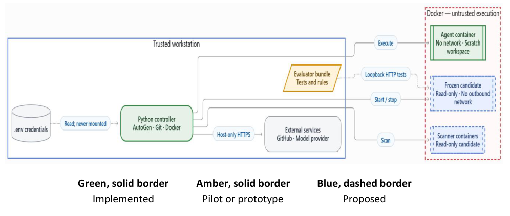

# Detailed Design Document

> Working Markdown import of the latest DDD supplied on October 14, 2026. Original: [DDD baseline PDF](../references/baselines/ddd_2026-10-14.pdf). The PDF labels this version 1.0 and contains an October 16 footer date; no approval date is inferred. Document claims about code and experiments are imported claims, not new verification. Tables and headings were converted for editing; figures preserve the supplied diagrams.

## Document Control

| Field | Value |
| --- | --- |
| Project | Microsoft 2, Team 3 |
| Course | CIS-4910 Senior Project Fall 2026 |
| Authors | Bruno Rocha; Kapil Srikanth; Ross Volenec; Joseph Bressani |
| Sponsors | Chad Hage; Brad Lawrence |
| Imported version | 1.0; source lists October 7 entries |
| Import date | 2026-10-14 |
| State | Working source; conversion review pending |

## Introduction

### Purpose

The Detailed Design Document (DDD) is meant to translate the System Requirement Specification (SRS) for this project into a implementable architecture. The harness provides an AI coding agent with a coding task, it will then run in a isolated sandbox and grade the results independently and publish a side- by-side comparison for different matrixes we believe most software engineers would deem valuable. These matrixes are correctness, security, code quality, token efficiency, and human help the agent’s needs. This document defines the architectural style, the components and their responsibilities, the interfaces between them, the data they persist, the infrastructure they run on, and the design decisions and trade-offs behind each choice.

### Sponsor and Context

The project is sponsored by Microsoft (Chad Hage, Brad Lawrence). The group must decide which AI coding agent to adopt and has no objective, repeatable way to compare the candidates. The initial agents are OpenAI Codex, Anthropic Claude Code, GitHub Copilot, and Google Gemini. Every agent runs against the same baseline model, so differences in the results come from the agent’s tooling, not the model.

### Scope

In scope:

- A standard reference application with automated tests (F1).

- Isolated, credential-free execution of agent-generated code (F2).

- Orchestration of agent runs under turn, time, token, and cost limits (F3).

- Independent grading, including secret and license scans (F4).

- Per-run telemetry and public results microsite (F5).

- A separate documentation-only feature assessment of commercial tools, Track A (F6, SRS Requirement 5), designed as module M11.

Out of scope:

- Installing, running, or live-testing the tools assessed in Track A.

- Training or fine-tuning models.

- Comparing models against each other.

- Benchmarks other than the JavaScript reference application.

- Running the harness as a hosted service; it runs on the operator’s machine.

- Deploying agent-generated code to any production system.

- Third-party extensions such as SpecKit in the baseline comparison

## Architectural Goals, Constraints and Assumptions

### Goals

The architecture is designed to achieve the following goals:

1. Repeatable evaluation: Give each agent the same baseline application, task prompt, permissions, and execution limits. Reset the application before every run.

2. Safe execution: Isolate agent-generated code from host credentials, unrelated files, and external networks.

3. Independent grading: Evaluate submitted changes using protected acceptance tests and security scans that the agent cannot modify.

4. Controlled automation: Allow agents to generate changes, receive execution feedback, and attempt corrections within defined resource and execution budgets.

5. Traceable results: Record configuration, test results, security findings, token usage, execution time, and human involvement for each run. Publish comparable results through the microsite.

6. Extensibility: Separate agent integrations from task definitions, sandbox management, and grading so additional agents can be evaluated without redesigning the entire harness.

7. Honest uncertainty (Track A): Report documented capability with a source for every finding, treat unknowns as “Not established” rather than as zero, and never present documented availability as measured effectiveness (SRS Requirement 5).

### Constraints

| ID | Constraints | Source | Architectural Impact |
| --- | --- | --- | --- |
| C-1 | The harness runs on the operator’s machine and not as a hosted service | SRS Scope | Local-first design: CLI Docker/embedded database; no multi-tenant web back end |
| C-2 | Only the JavaScript reference application is benchmarked | SRS Scope |  |
| C-3 | Budget is limited to the $100 Azure credit given to us by the sponsor. | Sponsor Kickoff Meeting | Hard per-trail token and cost caps; small baseline model; trial count configurable |
| C-4 | Fixed schedule based on the semester; Final Demo on Dec 4th,2026. | Course Syllabus | Limits scope of what can be done in the short amount of time provided. |
| C-5 | Agent-generated code is never deployed to production | SRS Scope | Execution limited to disposable containers; no deployment credentials in the sandbox |

| ID | Constraints | Source | Architectural Impact |
| --- | --- | --- | --- |
| C-6 | Each agent must be driven non-interactively | Repeatability Goal | Only agents with a headless/CLI mode are supported. |
| C-7 | USF policy, FERPA and Microsoft usage guardrails apply; sponsor workloads are monitored | Sponsor Kickoff Meeting | No personal data in results; least-privilege access to Azure; the public microsite contains only redacted, aggregated evidence. |
| C-8 | Demo expected at every weekly meeting; a video linked in the GitHub issue is acceptable | Sponsor Meeting, Oct. 9th | Runs are scripted as any member can demo them. |
| C-9 | Tools run in their shipped default configuration; extensions are excluded (e.g. SpecKit) | Sponsor Meeting, Oct. 9th | Record default model, reasoning, and approval modes. |

### Assumptions

| ID | Assumption | If false, then… |
| --- | --- | --- |
| A-1 | The operator’s workstation can run the Docker Engine and has a Desktop with at least 16 GB RAM and 100 GB free disk space. | Runs trials sequentially or uses an Azure VM as the operator machine |
| A-2 | Each agent CLI (Codex CLI, Claude Code, Copilot CLI, and Gemini CLI) supports a headless mode and either a base-URL override or reports token usage. | Adapter falls back to parsing the agent’s own usage output; result would be flagged for “self-reported usage” |
| A-3 | Published results contain no confidential information. | Publisher redaction rules block the publishing step. |
| A-4 | Model outputs are non-deterministic; N ≥ 3 trials per agent/task give a usable estimate | Increase N for close comparisons; report confidence intervals rather than single runs |
| A-5 | One member runs each tool end to end with identical task files and prompts | Results are not comparable; rerun from benchmark-start-v1 |
| A-6 | Each tool's models stay available through Dec. 4th | Record model version per run; a new version starts a new cohort |
| A-7 | Each tool reports per-run tokens | Token score is dropped; totals are out of 90 |

## Artificial Intelligence Impacts and Uses

### AI Assisted Content Notation

Portions of this document were prepared with the assistance of generative AI tools. As a team, any input received from AI was reviewed, edited, and verified against the contents of the SRS, sponsor meeting notes, and the project repository. Diagrams were produced with Mermaid to ensure a more professional view compared to doing it by hand.

## Scope of Project Architecture

The harness is a modular monolith organized as a layered architecture whose core workflow is a pipes-and-filters pipeline (Plan → Execute → Grade → Score → Publish). Agent integrations use a plug-in (microkernel) style: the orchestrator is the stable core, and each agent is an adapter loaded from a registry. Telemetry follows an event-based, append-only style (every stage emits events to a log that is later ingested). The results microsite follows a static-site (JAMstack) style. Each choice is tied to a requirement or constraint below; the rejected alternatives are discussed in ADR-01, ADR-05 and ADR-11.

### High Level Architecture (HLA)


Figure 1. High-level architecture and implementation status.

Green, solid border            Amber, solid border             Blue, dashed border Implemented                  Pilot or prototype                   Proposed

Figure 1. High-level architecture and implementation status. Green, solid border = implemented; amber, solid border = pilot or prototype; blue, dashed border = proposed.

Evidence producers generate candidate code or documented findings. Candidate code is graded inside the trusted evaluation boundary. Graded results become run records that a release builder publishes. Readers cannot start running.

### Architectural Views

#### Logical


The implementation differs from the SRS view: it uses CodeExecutorAgent instead of UserProxyAgent, wraps the model client instead of using a LiteLLM gateway, grades pull requests with code from the pull request itself, and does not publish run records.

#### Physical



Green, solid border       Amber, solid border        Blue, dashed border Implemented             Pilot or prototype              Proposed

#### Data


A RunRecord links one task, one profile, and one campaign to its calls and grader results. Corrections are separate records linked by phase and retry_of. Track A uses AssessmentCells. A release manifest selects reviewed records by hash.

## System Configuration Details

| Input | Behavior |
| --- | --- |
| Model profiles | local-dev (Ollama, default), azure-dev, azure-prod; only azure-prod is benchmark-valid |
| Limits | 5 autoreplies, 15,000 tokens |
| Secrets | Host. env variables; never in YAML |
| --timeout | 120 s per execution (SRS requires 60 s per command) |
| --network | Enables container networking; development only |
| --interactive | Real approvals; otherwise, five automatic approvals |
| --export-pr | Dry run unless --push; targets main although the default branch is master |

Staging does not exclude .env files, which violates Spec 1.2 if a target contains one. Proposed: copy only manifest-listed files and define each cohort in a committed campaign manifest (commit, tasks, suite hash, image digest, profile, limits, spend cap, metric contract).

| Component | Choice | Risk |
| --- | --- | --- |
| Orchestration | AutoGen 0.7.x | In maintenance mode; Microsoft Agent Framework recommended [17]. Pin and isolate (ADR-05). |
| Isolation | Docker, network none | Shares host kernel [16]; limits must be set |
| Testbed | Node 22, Express 4.22 | Pin lockfile |
| Records | JSON Schema 2020-12 [20] | Semantic checks still needed |
| Hosting and CI | GitHub Pages and Actions [19], [18] | Pin actions by commit SHA |

### System Inputs API if used

No hosted API is used. Inputs are local CLI, task files, and model profiles.

```text
python run_benchmark.py --task 001-add-delete-endpoint --model-profile azure-dev
```

The runner returns 0 after any completed run, even an unreliable one. Proposed exit codes: 0 passed, 1 failed, 2 invalid input or infrastructure error, 130 cancelled.

| Contract | Current | Proposed |
| --- | --- | --- |
| Task | ID, target, test command, framework, forbidden patterns; allowed files in prose | Machine-readable allowed files, suite ID, seed commit, hashes |
| Acceptance | npm test in the candidate's tree | Evaluator-owned suite with fixed test inventory |
| Model profile | Provider, deployment, benchmark_valid | Add version, settings hash, capability check |
| Tool profile | None | Tool, version, model, mode, approvals, integrations [8] |

The proposed model adapter records every call, including failures, with usage marked complete or unknown. It retries at most twice and ends the run as infrastructure_error after the third failure (Spec 2.5.3).

### System Output API if Used

The todo API is the application agents modify, not a harness service. State is in memory and resets on restart.

| Endpoint | Current (master) | Task 001 (benchmark-start-v1) |
| --- | --- | --- |
| GET /api/todos | 200, todo array | Unchanged |
| POST /api/todos | 201; 400 for missing or blank title | Unchanged |
| PUT /api/todos/:id | 200; 404 if missing | Unchanged |
| DELETE /api/todos/:id | Already present; accepts 1abc via parseInt | Removed from seed; agent must add strict ID checks (400/204/404) |

master's DELETE passes 3 of 9 pilot acceptance tests (V04), so task 001 on master is not usable for scoring until the branch is merged (D06). Outputs today: logs/<task>_<run>.json (schema 1) and a CI referee comment. Proposed: a schema 3 run record, grader evidence, an eligible patch, and a release bundle containing no prompts, secrets, or local paths (Spec 4.2.4).

### System Decomposition

The system is a modular application on the operator host with untrusted work isolated in containers. Candidate code never reaches the score writer, credentials, or publication.

| Module | Responsibility | Current code | Status | SRS |
| --- | --- | --- | --- | --- |
| M01 Contracts | Validate task, profile, policy, campaign | tasks.py, model_profiles.py | Partial | 2.3, 2.5 |
| M02 Controller | Lifecycle, budgets, final status | run_benchmark.py | Proposed | 2.1, 2.4, 2.5 |
| M03 Staging | Copy seed, prepare dependencies | staging.py | Partial | 1.2, 1.4 |
| M04 Model adapter | Provider calls, usage, retries | instrumented_client.py | Partial | 2.5, 4.2 |
| M05 Coder loop | Turns, feedback, approvals | orchestrator.py | Partial | 2.1, 2.2, 2.4 |
| M06 Sandbox | Container limits, watchdog, teardown | executor.py, base.py | Partial | 1.1, 1.3, 1.4 |
| M07 Freezer | Hash candidate, enforce manifest | None | Proposed | 2.3 |
| M08 Evaluation | Acceptance suites, scans, quality | graders/ | Partial | 1.5, 4.1, 4.3 |
| M09 Scoring | Dimensions, overrides, aggregation | scoring.py | Partial | Test Plan |
| M10 Record writer | Terminal record, atomic write | telemetry.py | Partial | 4.2 |
| M11 Assessment | Track A cells and review | Specification only [4]; stub record in sources/track_a_assessment.md | Proposed | 5.1–5.5 |
| M12 Export and referee | Patch export, CI regrade | pr_export.py, referee.py | Partial | 4.5 |
| M13 Release builder | Publish records to site | index.html prototype | Proposed | 4.4 |

### System Coupling

Dependencies point from policy toward adapters (Figure 4). Scoring imports no Docker or provider code; publication depends only on validated records.

| Boundary | Current | Proposed |
| --- | --- | --- |
| Task to grader | Task supplies a shell test command run in the candidate tree | Evaluator-owned suite ID |
| Executor to Docker | Global patch of the Docker SDK create call | Explicit per-container specification |
| Loop to limits | 10-message ceiling approximates 5 turns | Host counter of coder turns |
| Graders to workspace | Read-write mount of the agent workspace | Read-only frozen candidate |
| Scoring to tools | Tool error becomes a 0 score | Typed result; no score on tool failure |
| Export to Git | Commits scratch history to main | Apply patch onto upstream master |

A new task revision, grader version, or model version creates a new cohort; earlier results are not mixed with it.

### System Cohesion

Each module has one reason to change: runtime policy (M06), evaluation method (M08), formulas (M09), assessment rules (M11), or presentation (M13). Today run_benchmark mixes setup, grading, export, and record writing, so an export error can prevent the record from being written. The design separates these while keeping the existing SandboxRunner and GraderResult interfaces.

### Application servers

There is no harness application server; the controller is a local Python process. The only server is the testbed Express process (port 3000; tests use 3001 or an ephemeral port). Each run starts a fresh process, which resets state (Spec 3.1.2). The image does not include Express and staging skips node_modules, so offline grading needs a prepared dependency layer.

### Web servers

GitHub Pages serves the static site [19]. It runs no model code and has no backend. Spec 4.4 requires it to render results from committed records, label code as AI-generated, show model version and settings, and update within 2 minutes of a merge. The current index.html does not read records. WCAG 2.2 AA is the proposed accessibility target [23].

### Database servers, design and Schemas

No database server is used (Spec 3.1 prohibits one for the testbed). Records are versioned JSON files validated with JSON Schema 2020-12 [20]; the release builder checks references between files.

| Group | v1 (code) | v2 (SRS Appendix A) | v3 change (Proposed) |
| --- | --- | --- | --- |
| Identity | Task, run ID | Adds attempt 1–3 | Adds campaign, approach, phase, retry_of |
| Outcome | None | Status (5 values), error, turn count | Unchanged |
| Agent and model | Model label, profile | Agent and model name, version, settings | Allows unknown version with reason |
| Timing | Wall time (stops before grading) | Adds active time | Adds approval, grading, cleanup time |
| Usage and cost | Tokens; missing usage stored as 0 | Required integers; estimated cost | Null allowed when unknown |
| Scorecard | Five dimensions, reliable flag | Required scores, total_max, zeroed_by | Null scores for infrastructure_error |

v2 cannot record an unknown token count or an unscored infrastructure failure, so v3 is proposed as an SRS amendment (D05). The SRS states the schema file benchmark_run.schema.json is committed, but it is not in the repository.

- A passed run has a null error; any other status needs an error.

- A non-null zeroed_by forces total 0 and status failed.

- A null token score forces total_max = 90.

- Per-call tokens must sum to totals; every hash must resolve.

Track A cells use the fields in the feature matrix specification [4]: 2 configurations × 18 features = 36 cells. “Not established from documentation” is a valid result, not a zero. The set of profiles is not final: the matrix specification names two Copilot profiles and the whitepaper names three tools, so the cell count follows whichever profiles the team defines.

Track A data (SRS Specs 5.1–5.3; formats defined in [4]):

| Entity | Key fields | Rule |
| --- | --- | --- |
| Profile (MATRIX:C01…) | Configuration ID and name, category tags, tool and harness, operating modes, interface and location, model support, account and platform, included components, instructions and permissions, documentation coverage, assessment context | Not an installed or tested configuration; exclusions stated |
| Cell (MATRIX:F01…F18 × profile) | Status, supported/unsupported/unestablished scope, setup, activation, evidence basis, evidence references, gap reason, control mechanism, constraints, limitations, evaluator, assessment date | One of five statuses; never blank; never a score |
| Evidence entry (MATRIX:E01…) | Publisher, page title, URL, section, access date, version or update date, claim summary | Required for every status except Not established |

These records are stored as Markdown in sources/track_a_assessment.md and reviewed through the normal pull request. They are independent of RunRecords and of the run-record schema, and M13 does not publish them unless the team decides otherwise.

### Storage Requirements

Current sizes are small (app/ 24 KB, pipeline/ 952 KB). Run record size is not yet measured; a planning estimate of 5 MiB per run gives about 480 MiB for 96 runs [6]. Raw logs stay private; only redacted records enter Git. Retention periods need a decision (D09).

### Storage layout

| Path | Contents | Access |
| --- | --- | --- |
| pipeline/tasks/ | Task prompts and manifests | Reviewed changes only |
| evaluator/<suite>/ | Acceptance suites and hashes | Never mounted for the agent |
| schemas/ | Record schemas | Data owner |
| Temporary run folder | Workspace, then frozen candidate | Deleted after the record is written |
| benchmark-results/<approach>/<run>/ | Records, original and corrected files, test output | Written by host; reviewed before merge |
| site/data/<release>/ | Published JSON | Release builder only |

Files are written to a temporary path, validated, then renamed. Suite files are hashed after converting line endings to LF (V05).

## Module Specifications

| Module | Processing | Failure handling | Verification |
| --- | --- | --- | --- |
| M01 Contracts | Validate inputs and compute hashes before any run starts | Invalid input stops the run before an ID is assigned | Malformed and out-of-range inputs |
| M02 Controller | Assign run ID; check turn, time, token, spend, and rate budgets before each step | A finalizer always writes one record; one rerun for infrastructure errors | TC-2.1-x, TC-2.5-x |
| M03 Staging | Copy manifest files only; install from lockfile; record tree hash | Reject .env and links outside the target | TC-1.2-3, TC-1.4-2 |
| M04 Model adapter | Record every call with latency and usage completeness | Two retries, then infrastructure_error | TC-2.5-3, TC-4.2-3 |
| M05 Coder loop | Count turns; return output truncated to 2,000 characters; request approval after two failed turns | Approval expires after 180 s; run aborted | TC-2.2-x, TC-2.4-x |
| M06 Sandbox | Network none, non-root, 2 CPUs, 2 GB, 128 processes, 60 s watchdog | Kill and remove containers on every path | TC-1.1-x to TC-1.4-x |
| M07 Freezer | Stop agent, snapshot, hash, compare with seed | Out-of-manifest change: failed, total 0 | TC-2.3-x |
| M08 Evaluation | Run evaluator suites, secret scan, license scan, quality checks | Missing tool or report: infrastructure_error | TC-1.5-x, TC-4.1-x, TC- 4.3-x |
| M09 Scoring | Apply formulas, zero override, and aggregation | Refuse to score if a required dimension is missing | Formula fixtures |
| M10 Record writer | Validate and write one record atomically | On failure, block export and publication | TC-4.2-x |
| M11 Assessment | Define profiles; record each cell with a primary source and evidence index entry; second reviewer | No source: “Not established”; never scored | TC-5.1-x to TC-5.5-x; every cell (36 under the matrix specification's two profiles) |
| M12 Export and referee | Apply patch onto upstream; grade in CI from base branch | Unsafe history or failed checks: no export | TC-4.5-x |
| M13 Release builder | Validate and publish records with AI label and metadata | Any failed check keeps the previous release | TC-4.4-x |

### Module Design

Contracts and results are immutable in Python dataclasses. Adapters return typed outcomes instead of raising expected conditions. One scored run executes at a time; parallel runs wait until the global Docker patch is removed, and budget reservation is atomic. Testbed: baseline/ passes its 5 tests (V02); app/ fails because of a stray first line (V03), but SRS TC-3.3-1 names app/ as the clean baseline (D06). Task 001 on master describes a DELETE route that already exists; benchmark-start-v1 fixes this. Tasks T3–T8 from the SRS test plan is not yet written.

### Module Processing

1.   Validate the campaign, task, profile, limits, and host.

2.   Assign a run ID and stage the task without credentials.

3.   Start the container and confirm its limits.

4.   Before each model calls, check budgets; record the call.

5.   Request approval when Spec 2.4 requires the active clock pauses.

6.   Run each command under the 60 s watchdog; return sanitized output.

7. When finished or out of budget, freeze the candidate and check the manifest.

8. Grade with evaluator suites and scanners.

9. Score, clean up, and write the record.

| Event | Status |
| --- | --- |
| Secret or forbidden action | failed, total 0 (takes precedence) |
| Provider, environment, or tool failure | infrastructure_error (one rerun) |
| Active time reaches 120 s | timeout |
| Approval rejected or expired | aborted |
| Token limit reached | failed (token_limit_exceeded) |
| Work completed but not accepted | failed |
| All checks pass | passed |

### Interfaces

| ID | From → to | Contract | Rule |
| --- | --- | --- | --- |
| I01 | M01 → M02 | Validated inputs with hashes | Nothing runs until valid |
| I02 | M02 → M04 | Messages, request ID, token reservation | Every call recorded |
| I03 | M05 → M06 | Approved command | Output bounded |
| I04 | M06 → M05 | Exit code and output (≤ 2,000 characters) | Secrets redacted first |
| I05 | M07 → M08 | Frozen candidate ID | Read-only |
| I06 | M08 → M09 | GraderResult: suite hash, counts, findings | Missing report = unscored |
| I07 | M09 → M10 | Scores and total_max | Range-checked |
| I08 | M10, M11 → M13 | Validated public records | Secrets and mixed cohorts rejected |
| I09 | Tool adapter → M02 | Capability report: headless, model pinning, sandbox routing, usage | Missing capability = supervised only |

### Formulas & Algorithms

| Metric (weight) | Implemented | SRS v1.1 |
| --- | --- | --- |
| Functionality (35%) | Pass rate of the candidate's own tests | Pass rate of evaluator acceptance tests |
| Security (25%) | 100 if scans are clean, else 0 | 100 − 25 per new high or critical finding; secret sets total to 0 |
| Quality (20%) | Python-oriented checks; runtime within 2× baseline | Formatting, complexity ≤ 10, duplication, runtime within 1.2× |
| Tokens (10%) | 100 × (1 − U/L) | 100 up to 0.5L, then linear to 0 at L |
| Human help (10%) | −10 per correction | −25 per avoidable intervention, peer-rated |

```text
total = 0.35F + 0.25S + 0.20Q + 0.10T + 0.10H
```

```text
T = 100 if U <= 0.5L, else max(0, 200 * (1 - U/L))
```

```text
cost = sum(U_in * P_in + U_out * P_out) / 1,000,000
```

If any agent lacks token counts, T is dropped and totals are out of 90. Scores are averaged over three attempts per task, then across tasks, with min–max ranges and an instability flag. Example: 7,500 of 15,000 tokens scores T = 50 in the code and 100 under the SRS.

Task 001 ID rule: accept only digits representing a positive safe integer (01 valid; 0, -1, 1.5, 1abc return 400). parseInt alone is insufficient.

## Architecture Decision Records

| ADR | Decision | Alternative rejected | Status |
| --- | --- | --- | --- |
| 01 | Keep each comparison approach in a separate cohort | One combined leaderboard | Proposed |
| 02 | Local modular application with containers | Microservices or hosted queue | Proposed |
| 03 | Enforce limits on the host, not through prompts | Prompt instructions as controls | Partial |
| 04 | Grade with evaluator-owned acceptance suites | Agent's own tests | Used in pilot |
| 05 | Keep AutoGen behind an adapter; evaluate Microsoft Agent Framework later [17] | Immediate migration | Proposed |
| 06 | Record schema v3 as an SRS amendment | Relabel v1; store unknowns as 0 | Proposed |
| 07 | Version the metric contract | Silent renormalization | Proposed |
| 08 | Wrap the model client instead of a LiteLLM gateway | Extra proxy process | Implemented |
| 09 | JSON files and static site | Database server | Proposed |
| 10 | Export patches onto upstream history | Push scratch history | Proposed |
| 11 | Separate CI grading and publishing jobs; pin actions by SHA [18] | Grade with pull-request code | Proposed |
| 12 | Keep original and corrected attempts separately | Overwrite the original | Used in pilot |
| 13 | Assess commercial tools by documentation review only (Track A); keep it separate from Track B results | Live testing or benchmarking the tools; treating unknowns as zero scores | Proposed |

## System Size and Performance

The SRS campaign is 96 runs. At 120 s each, active agent time is at most 3.2 hours, excluding grading and reruns. No scored run has been timed yet.

| Target | Source | Current evidence |
| --- | --- | --- |
| ≤ 2 CPUs, 2 GB, 128 processes | Spec 1.3 | Not enforced |
| Command killed at 60–61 s | Spec 1.3 | Not implemented (120 s default) |
| Sandbox ready < 3 s; removed < 5 s | Spec 1.4 | Not measured |
| ≤ 5 turns, ≤ 120 s active | Spec 2.1 | Partial |
| Approval expires at 180 ± 1 s | Spec 2.4 | Not implemented |
| Test suite < 500 ms | Spec 3.1 | 318 ms, one local sample (V02) |
| UI update ≤ 100 ms | Spec 3.2 | Not measured |
| Telemetry overhead < 5% | Spec 4.2 | Not measured |
| Site updated ≤ 2 min after merge | Spec 4.4 | Not connected |
| CI grading ≤ 120 s | Spec 4.5 | Not measured |

Each result records the host profile (CPU, RAM, OS, Docker version, image digest). Results from different platforms are not combined.

Task 001 pilot (Oct. 9 sponsor meeting): Antigravity on its default model (Gemini 3.8 Flash) took about 6.5 minutes and passed all nine evaluator-owned acceptance tests after the “01” ID test was corrected;

Copilot CLI in Auto mode took just over one minute. Antigravity exceeds the 120 s active-time target, so that limit must be reviewed before scored runs.

## Security Considerations

Security is assessed as a property of the pipeline, not the model. Whether a secret leaks depends on the harness, its MCP tools and connectors, and the defaults it ships with, so each tool is first scored in its out-of-box configuration. This shows whether a pipeline is tuned for production-grade work or only for prototyping [3]. Table 21. Security Controls

| Threat | Spec | Control |
| --- | --- | --- |
| Secret or credential exposure | Spec 1.2, 4.1 | Credential-free staging; secret scan; any leak sets the total to 0 |
| Prompt injection in task or repository content [13] | Spec 1.1, 2.3 | No network; manifest-listed files only; limits enforced on the host |
| Over-broad tool approvals | Spec 2.4 | Record the approval mode (interactive or autopilot) and every approval |
| Sandbox escape or resource abuse [16] | Spec 1.3 | Non-root container; 2 CPUs, 2 GB, 128 processes; 60s watchdog [14] |
| Tampering with grading | Spec 2.3, 4.3 | Evaluator-owned suites outside the workspace; read-only frozen candidate |
| Leaks through published results | Spec 4.2.4 | Redacted records with no prompts, secrets, or local paths |

The referee workflow triggers on main, but the default branch is master. It builds graders from the pull request and comments in the same job (E15). The proposed workflow grades with base-branch code in an unprivileged job and publishes from a separate job (Spec 4.5). Legal items L1–L5 in the SRS map to these controls: spend and rate limits (L1), license scanning (L2), container limits (L3), dependency notices (L4), and redacted records with AI labeling (L5).

## References

[1] Microsoft 2 Team 3, “Microsoft-Capstone,” GitHub repository, commit 3589ef5, Oct. 2026. [Online]. Available: https://github.com/brunor560/Microsoft-Capstone

[2] J. Bressani, K. Srikanth, B. Rocha, and R. Volenec, “System Requirements Specifications,” ver. 1.1, Univ. of South Florida, Sept. 29, 2026.

[3] C. Hage and Microsoft 2 Team 3, sponsor meeting transcripts and notes, Sept. 4, Sept. 25, and Oct. 2, 2026.

[4] R. Volenec, “Agentic Developer Tool and Pipeline Feature Matrix Specification,” ver. 0.2, Oct. 2026, in [1].

[5] R. Volenec, “Detailed Design Document,” draft ver. 0.1, Oct. 8, 2026, in [1].

[6] K. Srikanth, “Detailed Design Document,” ver. 0.1, Oct. 9, 2026, in [1].

[7] Microsoft 2 Team 3, “Detailed Design Document,” ver. 0.2, Oct. 9, 2026.

[8] K. Srikanth, “DELETE endpoint pilot: shared team procedure,” branch results/antigravity-delete-run01, Oct. 7, 2026, in [1].

[9] Microsoft 2 Team 3, “Team Status Report and Timesheet, Week 3,” branch Documentation, in [1].

[10] Software, Systems and Enterprise: Architecture Description, ISO/IEC/IEEE 42010:2022, 2022.

[11] P. Kruchten, “The 4+1 view model of architecture,” IEEE Software, vol. 12, no. 6, pp. 42–50, Nov. 1995.

[12] National Institute of Standards and Technology, “Artificial Intelligence Risk Management Framework (AI RMF 1.0),” NIST AI 100-1, Jan. 2023.

[13] OWASP, “LLM01:2025 Prompt Injection.” [Online]. Available: https://genai.owasp.org/llmrisk/llm01-prompt-injection/

[14] Docker, “Resource constraints.” [Online]. Available: https://docs.docker.com/engine/containers/resource_constraints/

[15] Docker, “None network driver.” [Online]. Available: https://docs.docker.com/engine/network/drivers/none/

[16] Docker, “Docker Engine security.” [Online]. Available: https://docs.docker.com/engine/security/

[17] Microsoft, “AutoGen.” [Online]. Available: https://github.com/microsoft/autogen

[18] GitHub, “Secure use reference.” [Online]. Available: https://docs.github.com/en/actions/reference/security/secure-use

[19] GitHub, “What is GitHub Pages?” [Online]. Available: https://docs.github.com/en/pages/getting-started-with-github-pages/what-is-github-pages

[20] JSON Schema, “Draft 2020-12.” [Online]. Available: https://json-schema.org/draft/2020-12

[21] Software and Systems Engineering: Software Testing, Part 11: Guidelines on the Testing of AI-Based Systems, ISO/IEC TR 29119-11:2020, 2020.

[22] AboutCode, “ScanCode Toolkit documentation.” [Online]. Available: https://scancode-toolkit.readthedocs.io/

[23] W3C, “Web Content Accessibility Guidelines (WCAG) 2.2.” [Online]. Available: https://www.w3.org/TR/WCAG22/

## APPENDIX A: Acronyms

## APPENDIX B: Glossary of Terms

## APPENDIX C: Documents, type and source
